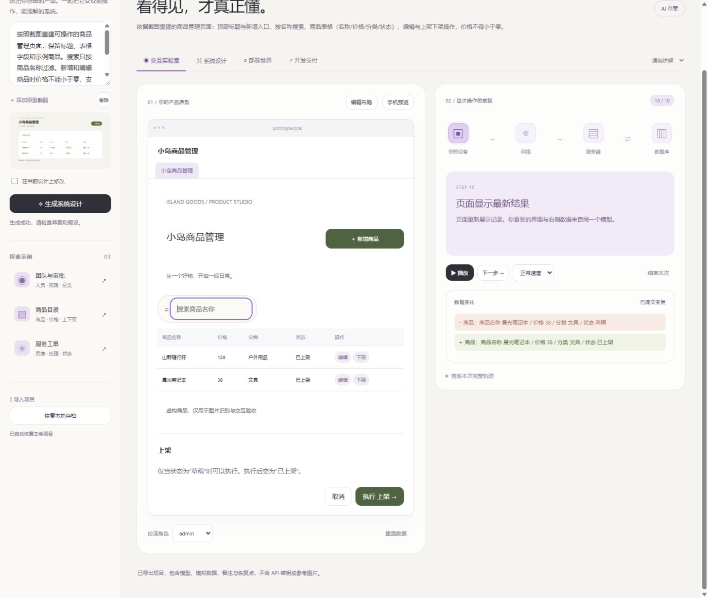
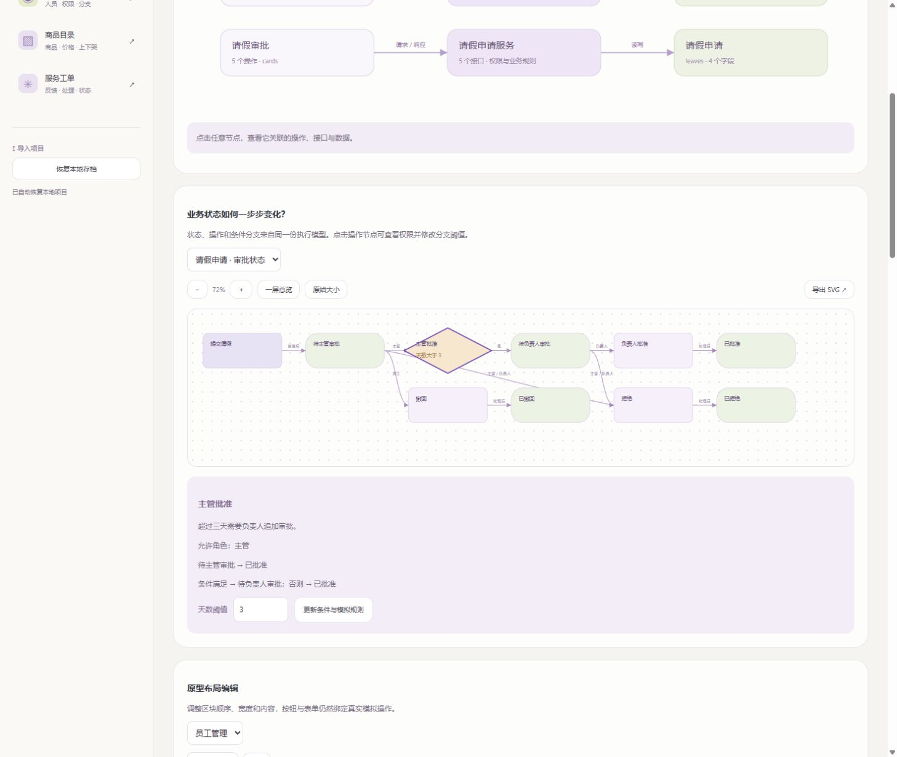
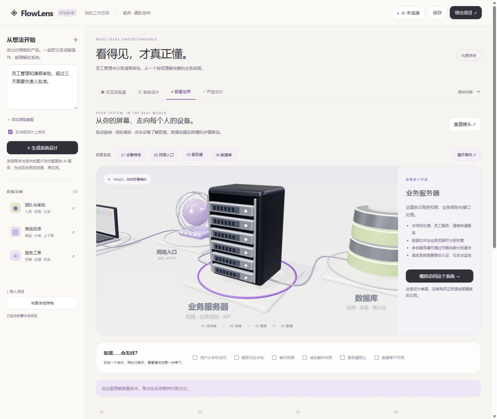

# FlowLens

[简体中文](README.md) · **English**

**[Try the live demo →](https://hanxiaochi.github.io/FlowLens/)**

No installation or API key needed. Start with a fictional inspection form, or explore approvals and 3D deployment in the interaction lab. AI generation is disabled in the public demo; your edits stay in your browser. The demo interface is currently in Chinese.

**Click a button. See where the request goes and what changes in the data.**

## Watch the walkthrough

This video covers the 1.0 prototype and system simulation. The new business forms workspace is described below.

https://github.com/user-attachments/assets/16c04fa8-d317-42ba-b5b7-97d5c65ea38b

**English narration and subtitles, 3 minutes 55 seconds.** Follow a five-day leave request through approvals, data changes, system diagrams, and a 3D deployment scene, then export the design for development.

[Watch / download the video](https://github.com/hanxiaochi/FlowLens/releases/download/v1.0.0/FlowLens-1.0-guide.en.mp4) · [Chapters and transcript](docs/video-guide.en.md) · [Download subtitles](https://github.com/hanxiaochi/FlowLens/releases/download/v1.0.0/FlowLens-1.0-guide.en.srt)

The recording uses the current Chinese interface, with English chapter titles, narration, and subtitles. It runs a built-in example; no paid model calls are made during the walkthrough.

## Why this exists

### Start with the forms you already use

Import DOCX files, configure fields in their original table structure, and pass the same record through review, return, revision, issue, receipt, and archive. Attachments, linked records, template snapshots, and step history stay with the record. Export a workspace package or a standalone printable HTML file.

Local acceptance checks imported 340 templates from four supervision document collections and exercised a complex inspection form. Extracted fields and workflow drafts still need business review. This is a local simulation stored in your browser, without authenticated multiuser access, electronic signatures, or production services.

[Usage guide (Chinese)](docs/forms-guide.md) · [Product goals (Chinese)](docs/forms-roadmap.md) · [Acceptance notes (Chinese)](docs/forms-acceptance.md)

You have an idea for a product, but explaining it to a developer is hard. You draw the screens, then realize the permissions, workflow, and database still need to be figured out. That is where FlowLens started.

Describe your idea or upload a prototype screenshot. FlowLens turns it into interactive pages and makes the process behind each button visible: who sends the request, which module handles it, where the rules apply, and how the data changes.

You do not need to understand the whole system before you can try it, change it, and bring something concrete to the discussion.



## Run it locally

You do not need an API key to start. Three built-in examples cover team management and approvals, a product catalog, and service tickets. Their interactions, execution traces, and 3D deployment scenes work offline.

Install [Node.js](https://nodejs.org/) 22 or a newer LTS version, then run:

```sh
git clone https://github.com/hanxiaochi/FlowLens.git
cd FlowLens
npm ci
npm start
```

Open [http://127.0.0.1:4173/](http://127.0.0.1:4173/).

On Windows, you can also double-click `启动 FlowLens.cmd`. It installs the runtime dependency on first launch. To skip that download, get the packaged ZIP from [Releases](https://github.com/hanxiaochi/FlowLens/releases), extract it, and run the launcher. You still need Node.js. The examples work offline; AI generation needs access to a model service.

## A good first run

1. Choose the team approval example (`团队与审批`) and submit a leave request.
2. Follow the steps on the right: validation, rule evaluation, and the database write. Play the sequence or advance one step at a time.
3. Switch roles and try another operation. See why some actions are allowed and others are rejected.
4. Open System Design (`系统设计`), change the approval threshold, and try the workflow again.
5. Open Deployment World (`部署世界`), simulate mobile access or a network failure, and see where the request stops.

The pages and diagrams use the same model. Change a rule and the next simulation follows it. Data writes happen during execution; this is more than a fixed animation.



## What version 1.0 can do

| What you want to understand | How to explore it |
| --- | --- |
| What would my idea look like? | Generate a draft from text or a screenshot; edit layouts, fields, and actions; preview a phone layout |
| What happens after a click? | Follow the execution trace, permissions, business rules, and before-and-after data |
| How do the frontend, backend, and database connect? | Explore module relationships, state workflows, and entity diagrams; export SVGs |
| Where does the software run? Can people use a phone? | Explore devices, network entry points, servers, and databases in 3D; simulate failures |
| What can I hand to a developer? | Export the project JSON, development notes, OpenAPI contract, and SQL draft |
| What if I make a mistake? | Save locally, restore earlier versions, import or export a project, and review AI changes before applying them |

## Make deployment easier to picture

Servers, databases, and network entry points do not have to remain abstract terms. Rotate the scene, zoom in, and select a device to understand its job.

Deployment suggestions take the audience, scale, mobile needs, budget, region, and maintenance capacity into account. They explain a possible setup. They do not buy cloud resources or deploy a real application.



## Connect your own model

Open the AI connection settings at the top right. Enter the service URL, model name, protocol, and API key. FlowLens supports interfaces compatible with **Chat Completions** or **Responses**. Use the API base URL; do not append `/chat/completions` or `/responses` yourself.

Text generation needs a text-capable model. Screenshot input also needs image support. Images can be PNG, JPEG, or WebP, up to 5 MB each. Compatibility and capabilities vary by provider and model, so check the provider's documentation.

Try a prompt like this:

> Build an employee directory and leave approval system. Employees submit requests, managers approve them, and requests longer than three days also need a department head's approval. Show employees and pending requests on the home page.

Review the generated pages, fields, and assumptions. To make a follow-up change, enable `在当前设计上修改` (modify the current design), then describe what should change. Failed or cancelled generation keeps the current project intact.

The API key stays in the local Node process memory and must be entered again after a restart. AI requests send your description, selected image, and—when revising—the current design to the configured provider. Offline examples make no model calls. Projects are stored in the current browser; export important work as JSON for backup.

## Current limits

FlowLens helps people understand, test, and discuss a product design. Version 1.0 is not a complete production application generator.

- Screenshot reconstruction is approximate, not pixel-perfect. Inferred business rules need human review.
- The current model covers CRUD operations, roles, references, state transitions, and numeric conditions. Complex transactions, arbitrary code, and complex date calculations are outside its scope.
- The backend and database in the demo are simulated. Exported contracts and SQL are starting points; real authentication, record-level access, concurrency, and operations still need implementation.
- Projects support local storage and file handoff, but not live multi-user collaboration.
- The local server listens only on loopback. It is not configured for public hosting. The 3D scene requires WebGL.
- The current application interface is Chinese. This README and the English video help English-speaking readers follow the workflow; they do not imply that the app has a complete English localization.

## Working on the code

There is no frontend build step. Edit a file and refresh.

| Files | Responsibility |
| --- | --- |
| `model.mjs` / `examples.mjs` | Shared model, execution rules, validation, and examples |
| `studio.js` / `studio.css` | Workspace interface and interactions |
| `layout.mjs` / `layout-ui.js` | Prototype layouts and editing |
| `diagrams.mjs` / `diagrams-ui.js` | System relationships and workflow diagrams |
| `scene.js` / `deployment.mjs` | Three.js scene and deployment suggestions |
| `server.mjs` | Local file server and model API proxy |
| `export.mjs` / `impact.mjs` | Handoff exports and change impact analysis |

```sh
npm test
```

Version 1.0 includes 46 automated tests covering model validation, permissions, state transitions, data changes, layouts, API adapters, timeouts, cancellation, migrations, and exports. Model API tests use local mock services and consume no credits. Passing them does not guarantee that every real model will generate a correct design.

The 3D scene uses [Three.js](https://threejs.org/). SQL validation tests use [PGlite](https://pglite.dev/). See [THIRD_PARTY_NOTICES.md](THIRD_PARTY_NOTICES.md) for dependency and license information. The project itself has not yet specified a license.

Found a problem or have an idea? Open an [issue](https://github.com/hanxiaochi/FlowLens/issues). Reproduction steps and a sanitized project file help. Please leave out API keys and real customer data.
