# FlowLens

[简体中文](README.md) · **English** · [v1.18.0 release](https://github.com/hanxiaochi/FlowLens/releases/tag/v1.18.0)

**[Try the live demo →](https://hanxiaochi.github.io/FlowLens/)**

No installation or API key needed. Start with a fictional supervision application, or explore approvals and 3D deployment in the interaction lab. AI generation is disabled in the public demo; your edits stay in your browser. The demo interface is currently in Chinese.

**Bring your customer's forms and ideas. Work out what the system should do together.**

FlowLens helps business users, implementation consultants, and forward-deployed engineers discuss requirements through working examples. Start with Word forms, natural language, or screenshots, review fields and workflow rules, then explore data changes and deployment choices before handing the design to developers.

Today you can try form workflows, interaction simulations, and exports of application definitions and API/SQL drafts. Imported Word forms need field and layout review. AI inputs require a configured model endpoint; the public demo uses built-in examples. The 1.20 candidate includes source references, open questions, and business confirmation records so developers can trace the reasoning behind each rule. See the [next-stage plan (Chinese)](docs/delivery-plan.md#discovery-next).


[Share trial feedback](https://github.com/hanxiaochi/FlowLens/issues/new?template=trial-feedback.yml) · [Launch notes and English post](docs/launch-kit.md)

[Product audit and proposed next steps (Chinese)](docs/fde-product-audit-2026-11-02.md) · [Discovery and acceptance worksheet (Chinese)](docs/fde-discovery-worksheet.md)

**New in 1.3** — Organize templates into an application, create projects, filter pending work by role, and carry fields from a completed instruction into its reply and archive record. Add repeating detail rows, preview supported natural-language rules, and export a restorable application with versioned API and SQL drafts.

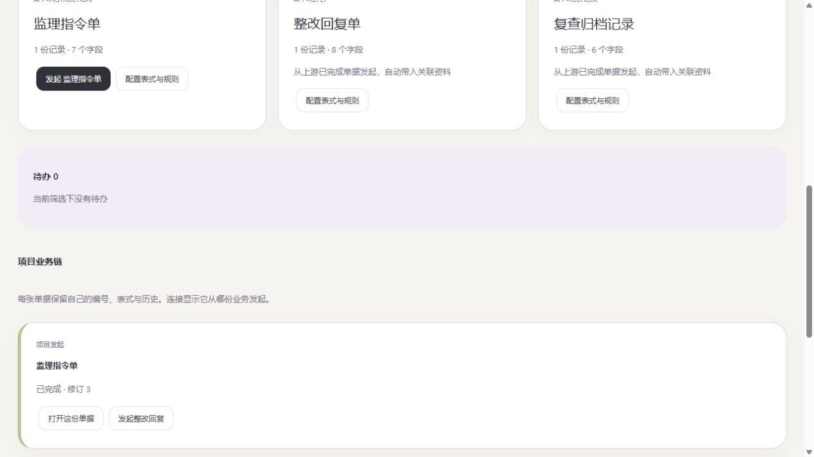

[1.3 release notes and acceptance](docs/release-1.3.0.md)

## Release candidate: review project records before handoff

### Requirements discovery on the main branch

**1.20.0-rc.1** is available as a prerelease with local, team, source, and public-demo archives. The hosted demo and production cloud remain on 1.18.0. [Download the candidate](https://github.com/hanxiaochi/FlowLens/releases/tag/v1.20.0-rc.1) · [Release notes](docs/release-1.20.0-rc.1.md)

- **Discovery worksheets** capture the business problem, current process, scope, source material, open questions, and deployment conditions.
- **Requirement evidence and reviews** link customer statements to forms, fields, or workflow steps. Reviews retain their definitions and require another check after changes.
- **Scenario checks** support generated samples, custom fields and detail rows, and cross-form instruction, reply, and archive flows. Reports retain inputs, roles, state changes, carried fields, and failure reasons.
- **Field observations** record expected and actual results, evidence locations, and follow-up work. Names and conclusions are entered by the recorder.
- **Developer handoff** brings together requirements, stale evidence, forms with no linked requirements, and contract file paths. Application ZIPs include the index, complete histories, API/SQL drafts, and a local verifier.

Review and single-form evidence track the linked form; cross-form history tracks the complete application definition. Team publication previews show affected records. Older packages inherit existing histories, and publication rejects history removal or replacement. An application can retain 10 cross-form reports of up to two million characters each. Participants still need to check requirement coverage and business meaning.

All 183 local tests passed. Browser checks covered saving, reloads, downloads, cross-tab conflicts for scenario history and observations, retained draft downloads, and narrow screens. Downloaded delivery packages were extracted and executed. The team browser flow restored an exported project, retained its evidence history, and saved further edits in the restored copy. Real business trials, production authorization, and deployment acceptance remain tracked in the [development plan (Chinese)](docs/delivery-plan.md#discovery-next).

The team app now separates fields still due at the current stage, issues in completed stages, and attachments whose verification is incomplete. Open a record from the review and return to the same page. Download a readable HTML checklist for review or printing without additional software.

[Candidate user guide](docs/project-review-guide.en.md)

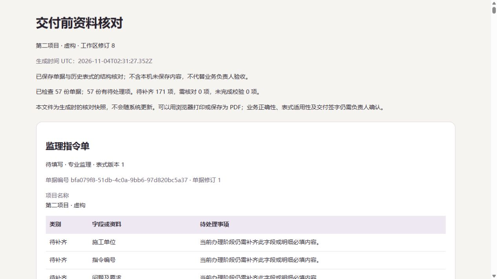

The review list now supports issue categories, record/summary search, and records your assigned roles can handle. Returning from a record preserves the filters and page. Downloads still include the whole project.

Project review was introduced in **1.19.0-rc.2** and is included in the 1.20 candidate. The stable and cloud versions remain **1.18.0**. At that stage, all 158 local tests passed, including attachment and report capacity limits, search across pages, and role-based review filters. Pagination, record navigation, downloading, and narrow-screen reading have been checked in the browser. Printed pagination and release acceptance still need verification. See the [delivery plan (Chinese)](docs/delivery-plan.md).

## 1.18 take your project ledger into Excel

The team app now exports an XLSX workbook with one row per record and separate detail sheets linked by record ID. Different historical form structures get separate sheets. Long identifiers, leading zeros, and formula-like input remain text. Use this workbook for review and handoff; use the project archive for attachments, workflow history, and recovery.

Checked in desktop Excel and against an actual browser download containing 57 fictional records, 342 field values, and their detail rows. All 145 local tests, 23 checks against the downloaded release runtime, and cross-platform CI passed. The cloud app has been upgraded: five-account data comparisons and 10 ledger downloads matched. All 45 public demo files matched the build. See the [release notes and acceptance status (Chinese)](docs/release-1.18.0.md).

## 1.17 find imported records by batch

You can close the import result page and come back later. Open **Import batch history** from the project to find the records, check their current workflow stages, open a form and return to the same page. Receipts can be downloaded again. Dates missing from older receipts are labeled as unknown.

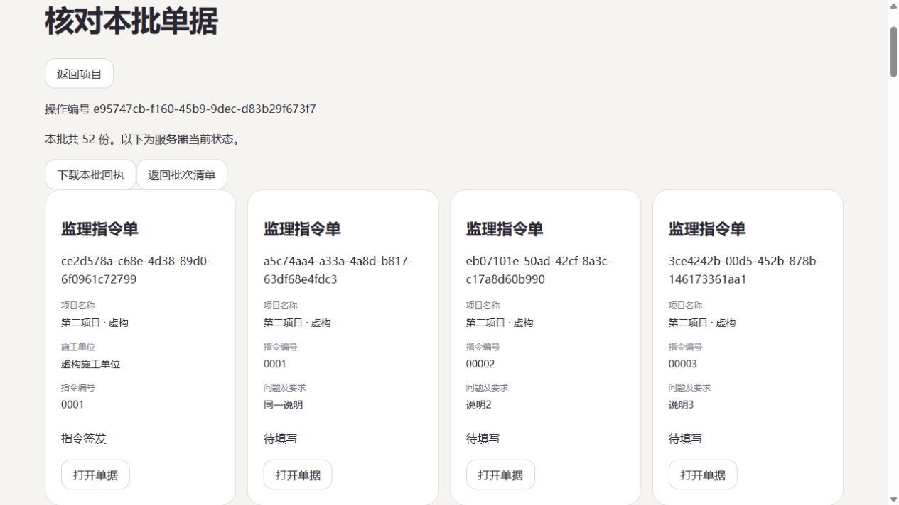

All 138 local tests pass. The downloaded release passes 22 runtime checks. Cross-platform CI, cloud data comparisons and restore checks pass, and all 45 public demo files match. [Release notes (Chinese)](docs/release-1.17.0.md)

## 1.16 bring an existing ledger into the workflow

Choose a CSV in your project, map columns to form fields, and review invalid values, duplicate mapped rows and project-value overrides before creating drafts. Identifiers remain text. Fill in required values and continue through the existing workflow. Remapping keeps the file and selections, and interrupted confirmations can resume with the original request.

All 137 local tests and 21 standalone runtime checks pass. Final cross-platform CI and five-account cloud comparisons pass. The downloaded runtime passes all 21 checks, and all 45 public demo files match. [Release notes (Chinese)](docs/release-1.16.0.md)

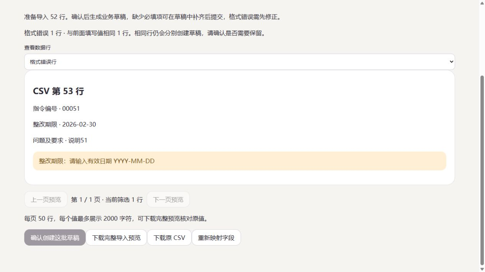

## 1.15 check who can handle each step

The admin page lists each project's roles and active members, highlighting roles that still need someone assigned. Jump to project permissions and keep the current selection after saving. Empty instances provide a setup entry, with guidance for applications that have no projects yet.

All 125 local tests and 20 standalone runtime checks pass. Cross-platform CI, five-account cloud comparisons, 20 downloaded-runtime checks and backup restoration pass. All 45 public demo files match. [Release notes (Chinese)](docs/release-1.15.0.md)

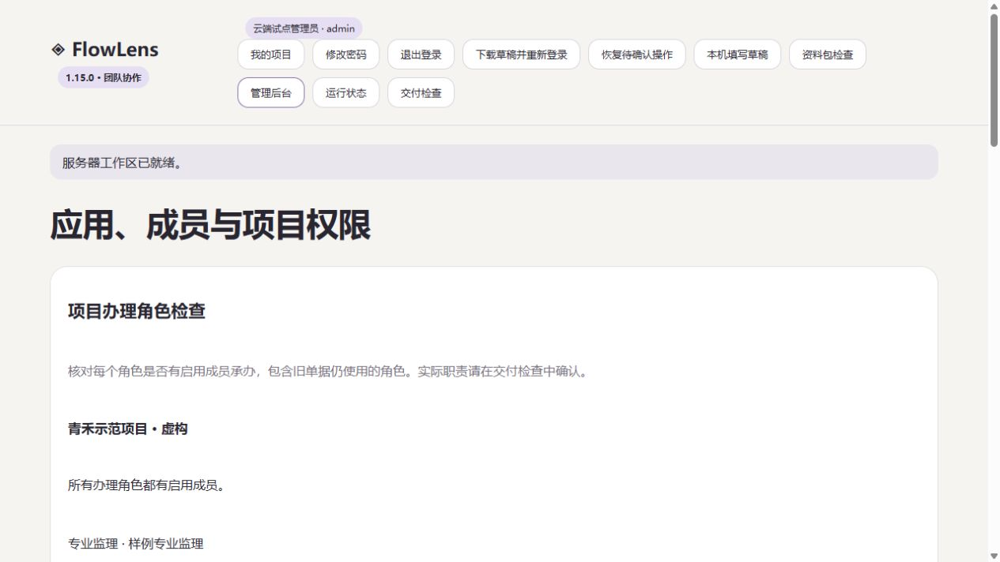

## 1.14 review changes before publishing

Upload an update package, compare fields, workflows and form layouts, then confirm publication. An outdated preview asks for another review. If the response is lost, continue with the original request. Existing records retain their historical templates.

All 124 local tests and 19 standalone runtime checks pass. Final cross-platform CI and five-account cloud data comparisons pass. [Release notes (Chinese)](docs/release-1.14.0.md)

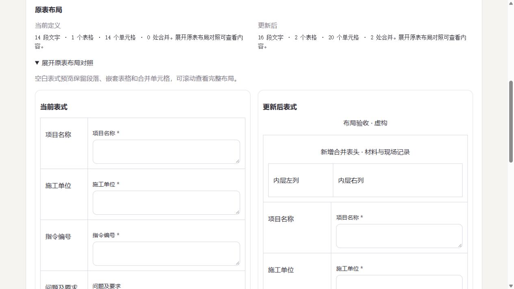

## 1.13 choose what each record card shows

Open a form template’s summary settings and choose up to three fields in display order. Record numbers, deadlines and issue descriptions can appear directly on the card. Local records, project cards and the team list share the configuration, which travels with exported applications. Existing records retain the template snapshot they were created with.

All 116 tests and cross-platform CI pass. Browser acceptance covers configuration, application handoff, failed saves and narrow screens. The cloud app has been upgraded. [Release notes (Chinese)](docs/release-1.13.0.md)

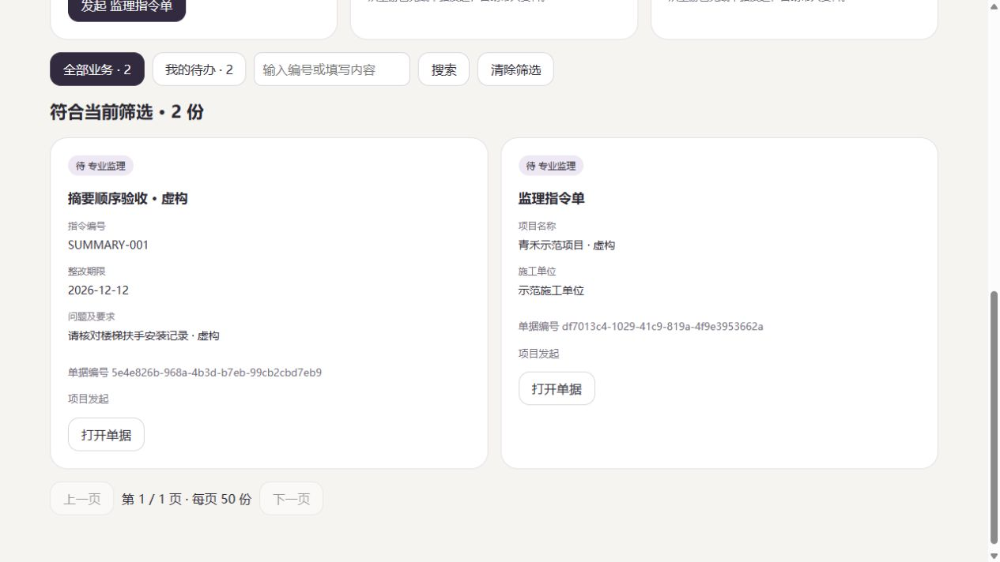

## 1.12.1 fixes fresh creation

Fixes the Create action before any record has been opened, and local draft saving for blank records at revision zero. All 113 local tests pass. [Patch notes (Chinese)](docs/release-1.12.1.md)

## 1.12 keeps work in progress

Record cards now show IDs and field previews. Text, detail rows and action notes are saved as local drafts, available from the header after reload or sign-in. Each editing page keeps its own copy. A successful submission cleans up only its linked draft. When the server revision changes, the comparison view helps you reconcile the differences manually.

All 111 tests and cross-platform CI pass. Browser acceptance covers reload recovery, competing editors, permission changes and combined failure paths. The cloud app has been upgraded. [Release notes and storage scope (Chinese)](docs/release-1.12.0.md)

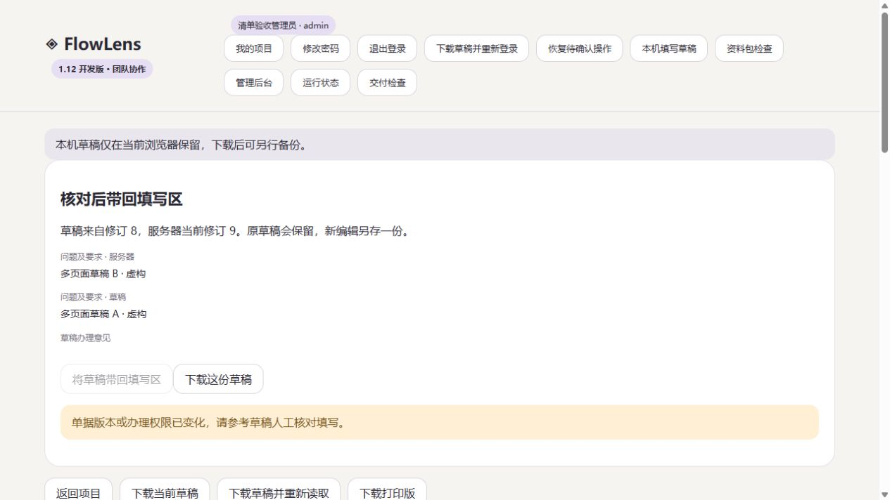

Drafts stay in this browser. Clearing site data deletes them; cross-device draft sync is still pending.

## 1.11 resumes business actions after a reload

Business requests are stored in the current browser before they are sent. After a lost response or page reload, sign in with the original account to confirm the action, download its original request, or inspect the project first. Acceptance covers competing tabs, re-login, an 8 MiB attachment and storage failure, alongside 104 regression tests. [Scope and acceptance (Chinese)](docs/release-1.11.0.md)

Recovery records stay in this browser's site data. Text still being edited can be preserved with the draft download control.

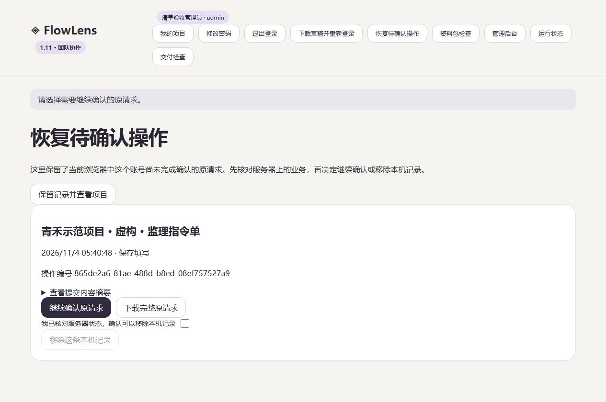


## 1.4 adds a shared team workspace

1.4.1 fixes successful logins exhausting a shared proxy's login allowance. Windows and Ubuntu each pass 70 regression tests. Linux container and Compose/Caddy checks cover writes, backup restoration, and HTTPS re-login. Relevant code changes trigger these checks automatically. [Cross-platform acceptance run](https://github.com/hanxiaochi/FlowLens/actions/runs/41479752796)

Post-release tests on main verify full rollback and retry after a late transaction failure, plus byte-for-byte attachment restoration. Windows and Ubuntu now each pass 71 tests. [Latest acceptance](https://github.com/hanxiaochi/FlowLens/actions/runs/41480784477) · [Delivery audit (Chinese)](docs/delivery-plan.md)

A Windows LAN pilot has passed five-account HTTPS workflow, restore, and browser UI checks on the server itself. Access from another computer and real-business approval remain pending. [Pilot status (Chinese)](docs/delivery-plan.md)

An owner-hosted Tencent Cloud pilot has since passed public-IP HTTPS, five-role workflow, concurrent-write conflict, and database restoration checks. Daily backups are enabled. Real-business approval and longer-term operation remain under validation. [Cloud acceptance and screenshot](docs/cloud-pilot-2026-11-03.md)

1.10.2 protects unresolved business requests after a lost response. Repeated button clicks preserve the original operation, and a failed list refresh is distinguished from a failed save. Browser fault-injection checks cover creation and save retries. [Scope and recovery guidance (Chinese)](docs/release-1.10.2.md)

1.10.1 removes a redundant workspace copy during server saves. In the same isolated 500-record test, two-minute sustained writes increased from 283 to 325 and request P95 fell from 730 ms to 569 ms. Cross-platform regression coverage now includes 94 tests, with five-account cloud verification passing. [Update and measurement scope (Chinese)](docs/release-1.10.1.md)

## 1.10 · Find a record, then open it

Projects now show 50 records per page, with search across identifiers and saved field values. Pending counts cover the whole project. Full forms, repeating rows and history load when a record opens. A completed record stays available after it leaves the pending filter.

Windows and Ubuntu each pass 93 tests, with container and five-account cloud checks also passing. In the isolated 500-record test, two-minute sustained writes increased from 241 to 283. Sustained request P95 was slightly higher. [Results and scope (Chinese)](docs/release-1.10.0.md)

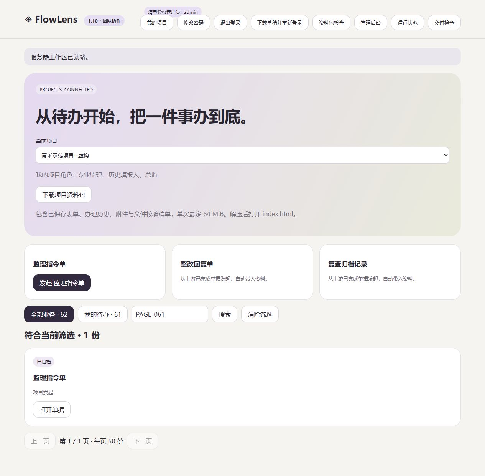

## 1.9 restores an archive into a working project

After checking an archive, name the new project, assign members, review the plan and confirm. FlowLens remaps internal identifiers and record links while preserving saved values and clearly marking external history. A confirmed request can be retried after a lost response, including after a page reload. Cloud checks cover unchanged source data, attachment downloads, role enforcement and continued work. Restoration currently creates an independent project. Merging into an existing project remains planned. [Scope and acceptance notes (Chinese)](docs/release-1.9.0.md)

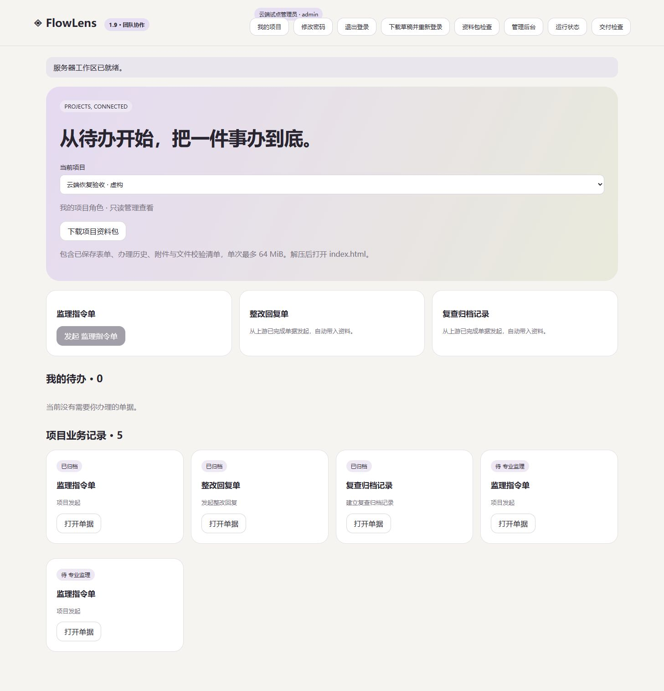

An isolated capacity baseline now covers 50 and 500 fictional records with 24 MiB of attachments. State consistency, retries, restart and restore checks pass. Full-workspace refreshes show higher latency at 500 records, so the next step separates list data from record details. [Environment, measurements and scope (Chinese)](docs/capacity-baseline-2026-11-04.md)

## 1.8 checks a handoff before you accept it

Admins can upload a project ZIP to verify its files, attachment references and record relationships, then review existing identifiers, template differences and roles that need confirmation. Reports can be downloaded. Windows and Ubuntu each pass 87 tests, and container acceptance passes. This release provides validation and restore preflight. Archive restoration remains in development. [Scope and acceptance notes (Chinese)](docs/release-1.8.0.md)

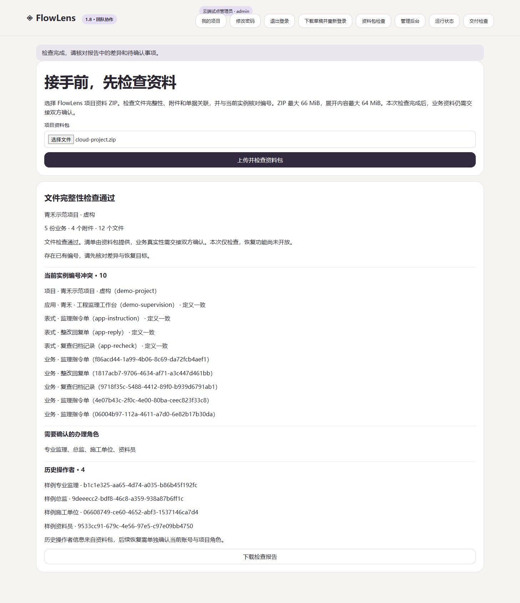

## 1.7 exports a project handoff archive

Download a project ZIP from the team workspace. It includes printable forms, workflow history, linked records, original attachments and a SHA256 manifest. Extract the archive and open index.html to find each document. The server checks current project access, limits an export to 64 MiB, and releases its transfer slot when a download ends or is interrupted. Windows, Ubuntu and container acceptance pass, with 82 automated tests. [Release notes and remaining checks (Chinese)](docs/release-1.7.0.md)

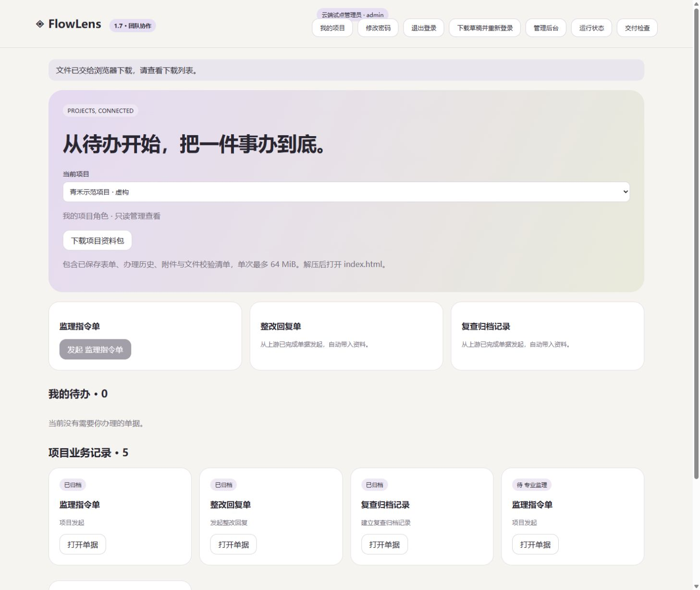

## 1.6 gives attachments their own storage

Attachments now live as verified binary data in SQLite. Project pages load metadata and fetch files on demand, with current membership checks, cancellation and a download timeout. Existing databases migrate with a pre-migration snapshot, and backups include every attachment. The cloud pilot passed upload, byte-for-byte download and restore checks with three synthetic 8 MiB files. All 79 automated tests pass. Real workload capacity and customer workflows remain under validation. [Upgrade and acceptance notes (Chinese)](docs/release-1.6.0.md)

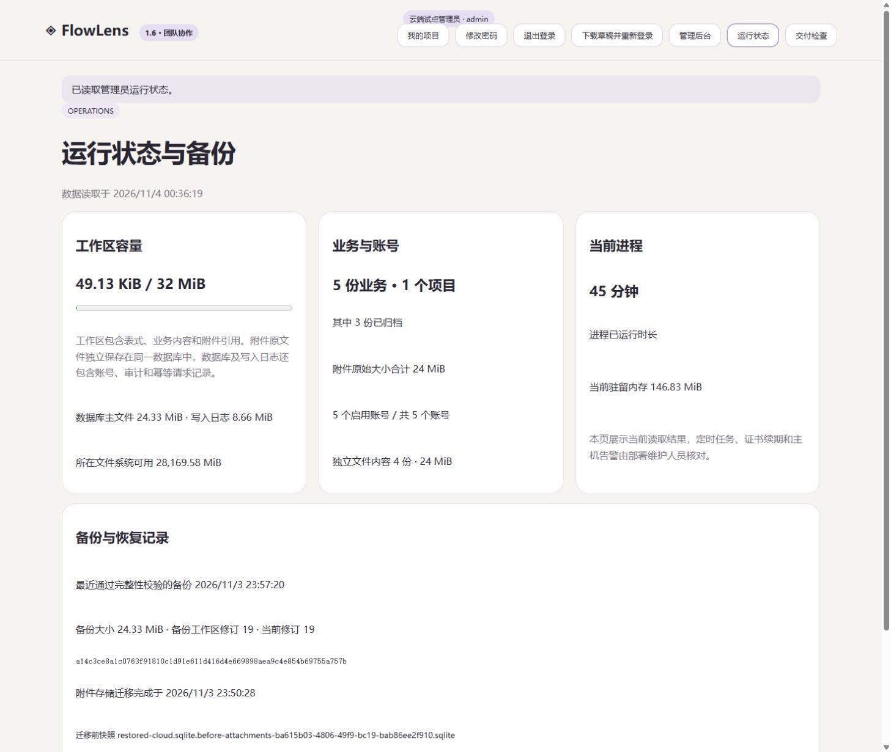

## 1.5 operations and delivery checks

Admins can inspect capacity, account counts, verified backup metadata, and restore markers. Instance and project checklists retain reviewers, evidence, recording accounts, and history. Revision and configuration guards handle concurrent changes, and restoration triggers review. The cloud service has been backed up and upgraded. Windows and Ubuntu each pass 73 tests. [Release notes](docs/release-1.5.0.md) · [Plan and pending decisions](docs/delivery-plan.md)

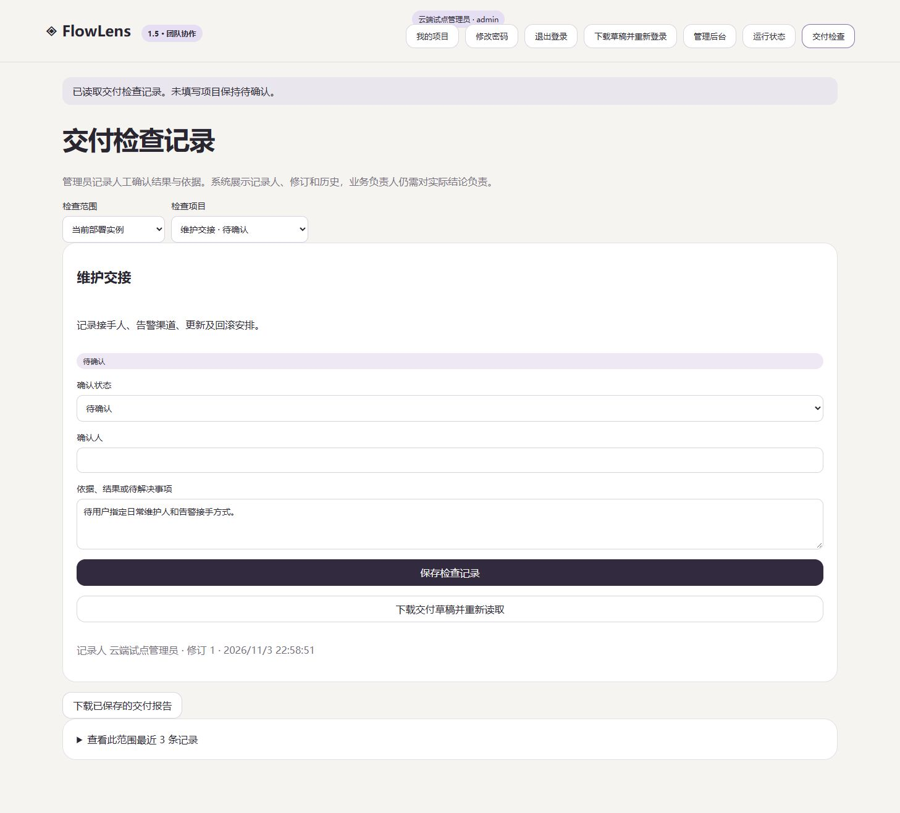

Import an application package into the self-hosted team service, create accounts, and assign project roles. A supervisor can issue an instruction, a contractor can reply using a separate account, and a records officer can archive it. The server stores forms, attachments, and the account behind each operation.

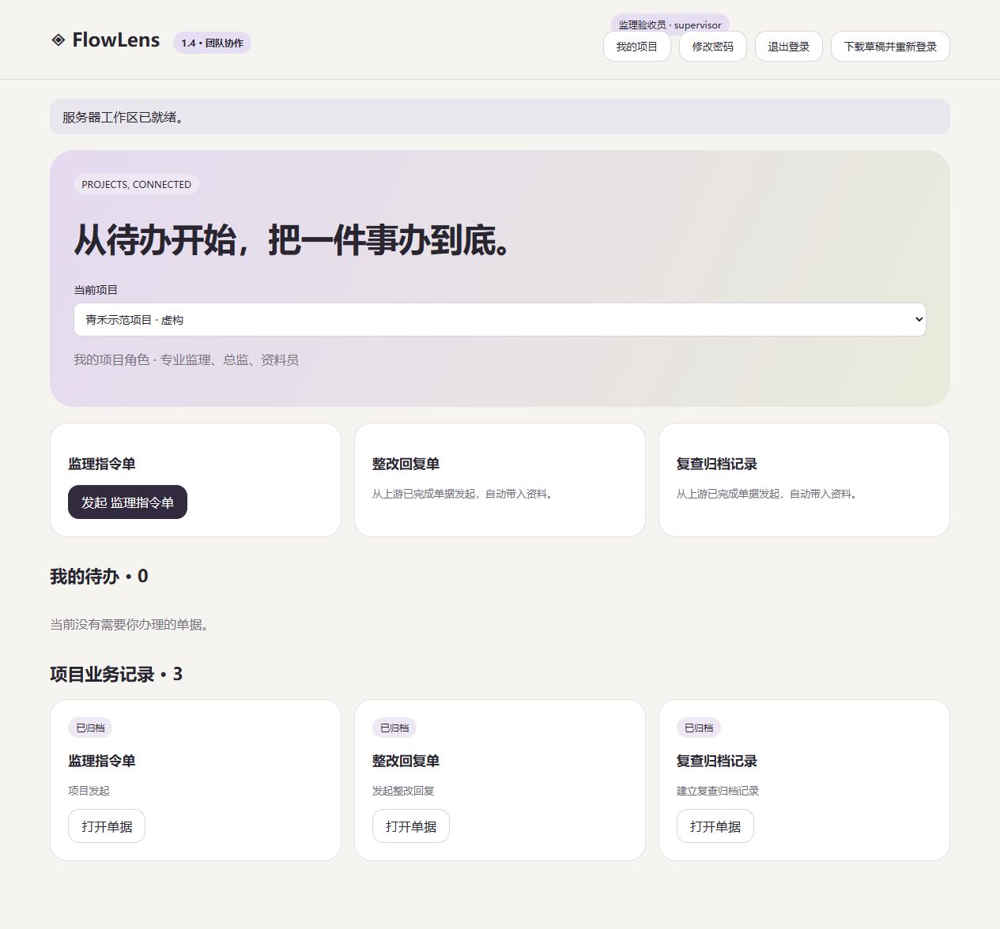

The server checks project roles, workflow stages, and record revisions. Repeated requests reuse their result. This release also adds account deactivation, password changes, audit history, versioned template publication, and SQLite backup and restore tools.

Download `FlowLens-1.17.0-team.zip`, install Node.js 24 LTS, initialize the administrator, then run `npm start`. The team runtime bundles its required files and needs no npm install. See the [deployment guide (Chinese)](docs/team-deployment.md) and [release acceptance](docs/release-1.13.0.md).

The public demo runs locally in your browser. The shared service is self-hosted and intended for a small-team pilot. Cloud technical acceptance is recorded. Customer workflows, sustained capacity, and maintenance handover still need validation.

## Watch the walkthrough

The 1.3 design-workspace video follows the application through detail rows, linked forms, review returns, package restoration, and development handoff.

https://github.com/user-attachments/assets/3a3c4347-98a1-4a2f-bd33-750183186221

**English synthesized narration and subtitles, 3 minutes.** This step-by-step video uses captures from the actual Chinese interface and fictional data.

[Watch / download](https://github.com/hanxiaochi/FlowLens/releases/download/v1.3.0/FlowLens-1.3-guide.en.mp4) · [Chapters and transcript](docs/video-guide.en.md) · [Subtitles](https://github.com/hanxiaochi/FlowLens/releases/download/v1.3.0/FlowLens-1.3-guide.en.srt)

The rule assistant uses a documented local grammar and requires confirmation before applying a draft. Application data lives in the current browser. Production use needs server authentication, project permissions, shared storage, and operational backups.

## Why this exists

### Start with the forms you already use

Import DOCX files, configure fields in their original table structure, and pass the same record through review, return, revision, issue, receipt, and archive. Attachments, linked records, template snapshots, and step history stay with the record. Export a workspace package or a standalone printable HTML file.

Local acceptance checks imported 340 templates from four supervision document collections and exercised a complex inspection form. Extracted fields and workflow drafts still need business review. This is a local simulation stored in your browser, without authenticated multiuser access, electronic signatures, or production services.

[Usage guide (Chinese)](docs/forms-guide.md) · [Product goals (Chinese)](docs/forms-roadmap.md) · [Acceptance notes (Chinese)](docs/forms-acceptance.md)

You have an idea for a product, but explaining it to a developer is hard. You draw the screens, then realize the permissions, workflow, and database still need to be figured out. That is where FlowLens started.

Describe your idea or upload a prototype screenshot. FlowLens turns it into interactive pages and makes the process behind each button visible: who sends the request, which module handles it, where the rules apply, and how the data changes.

You do not need to understand the whole system before you can try it, change it, and bring something concrete to the discussion.


## Run it locally

You do not need an API key to start. Three built-in examples cover team management and approvals, a product catalog, and service tickets. Their interactions, execution traces, and 3D deployment scenes work offline.

Install [Node.js](https://nodejs.org/) 24 or a newer LTS version, then run:

```sh
git clone https://github.com/hanxiaochi/FlowLens.git
cd FlowLens
npm ci
npm start
```

Open [http://127.0.0.1:4173/](http://127.0.0.1:4173/).

On Windows, you can also double-click `启动 FlowLens.cmd`. It installs the runtime dependency on first launch. To skip that download, get the packaged ZIP from [Releases](https://github.com/hanxiaochi/FlowLens/releases), extract it, and run the launcher. You still need Node.js. The examples work offline; AI generation needs access to a model service.

## A good first run

1. Choose the team approval example (`团队与审批`) and submit a leave request.
2. Follow the steps on the right: validation, rule evaluation, and the database write. Play the sequence or advance one step at a time.
3. Switch roles and try another operation. See why some actions are allowed and others are rejected.
4. Open System Design (`系统设计`), change the approval threshold, and try the workflow again.
5. Open Deployment World (`部署世界`), simulate mobile access or a network failure, and see where the request stops.

The pages and diagrams use the same model. Change a rule and the next simulation follows it. Data writes happen during execution; this is more than a fixed animation.


## What version 1.0 can do

| What you want to understand | How to explore it |
| --- | --- |
| What would my idea look like? | Generate a draft from text or a screenshot; edit layouts, fields, and actions; preview a phone layout |
| What happens after a click? | Follow the execution trace, permissions, business rules, and before-and-after data |
| How do the frontend, backend, and database connect? | Explore module relationships, state workflows, and entity diagrams; export SVGs |
| Where does the software run? Can people use a phone? | Explore devices, network entry points, servers, and databases in 3D; simulate failures |
| What can I hand to a developer? | Export the project JSON, development notes, OpenAPI contract, and SQL draft |
| What if I make a mistake? | Save locally, restore earlier versions, import or export a project, and review AI changes before applying them |

## Make deployment easier to picture

Servers, databases, and network entry points do not have to remain abstract terms. Rotate the scene, zoom in, and select a device to understand its job.

Deployment suggestions take the audience, scale, mobile needs, budget, region, and maintenance capacity into account. They explain a possible setup. They do not buy cloud resources or deploy a real application.


## Connect your own model

Open the AI connection settings at the top right. Enter the service URL, model name, protocol, and API key. FlowLens supports interfaces compatible with **Chat Completions** or **Responses**. Use the API base URL; do not append `/chat/completions` or `/responses` yourself.

Text generation needs a text-capable model. Screenshot input also needs image support. Images can be PNG, JPEG, or WebP, up to 5 MB each. Compatibility and capabilities vary by provider and model, so check the provider's documentation.

Try a prompt like this:

> Build an employee directory and leave approval system. Employees submit requests, managers approve them, and requests longer than three days also need a department head's approval. Show employees and pending requests on the home page.

Review the generated pages, fields, and assumptions. To make a follow-up change, enable `在当前设计上修改` (modify the current design), then describe what should change. Failed or cancelled generation keeps the current project intact.

The API key stays in the local Node process memory and must be entered again after a restart. AI requests send your description, selected image, and—when revising—the current design to the configured provider. Offline examples make no model calls. Projects are stored in the current browser; export important work as JSON for backup.

## Current limits

FlowLens helps people understand, test, and discuss a product design. The self-hosted team service adds shared business execution.

- Screenshot reconstruction is approximate, not pixel-perfect. Inferred business rules need human review.
- The current model covers CRUD operations, roles, references, state transitions, and numeric conditions. Complex transactions, arbitrary code, and complex date calculations are outside its scope.
- The backend and database in the demo are simulated. Exported contracts and SQL are starting points; the team service now provides accounts, project access, revision checks, and backups. Record-level access and production integrations need project-specific work.
- The team service supports shared project workflows. Users refresh to fetch changes from colleagues. Push updates and record-level confidentiality remain future work.
- The design server defaults to loopback. External access to the team service requires HTTPS and a correctly configured origin. The 3D scene requires WebGL.
- The current application interface is Chinese. This README and the English video help English-speaking readers follow the workflow; they do not imply that the app has a complete English localization.

## Working on the code

There is no frontend build step. Edit a file and refresh.

| Files | Responsibility |
| --- | --- |
| `model.mjs` / `examples.mjs` | Shared model, execution rules, validation, and examples |
| `studio.js` / `studio.css` | Workspace interface and interactions |
| `layout.mjs` / `layout-ui.js` | Prototype layouts and editing |
| `diagrams.mjs` / `diagrams-ui.js` | System relationships and workflow diagrams |
| `scene.js` / `deployment.mjs` | Three.js scene and deployment suggestions |
| `server.mjs` | Local file server and model API proxy |
| `export.mjs` / `impact.mjs` | Handoff exports and change impact analysis |

```sh
npm test
```

Version 1.0 includes 46 automated tests covering model validation, permissions, state transitions, data changes, layouts, API adapters, timeouts, cancellation, migrations, and exports. Model API tests use local mock services and consume no credits. Passing them does not guarantee that every real model will generate a correct design.

The 3D scene uses [Three.js](https://threejs.org/). SQL validation tests use [PGlite](https://pglite.dev/). See [THIRD_PARTY_NOTICES.md](THIRD_PARTY_NOTICES.md) for dependency and license information. The project itself has not yet specified a license.

Found a problem or have an idea? Open an [issue](https://github.com/hanxiaochi/FlowLens/issues). Reproduction steps and a sanitized project file help. Please leave out API keys and real customer data.

## Development status

Version 1.14 is adding definition-publication previews and recovery. The server now provides a read-only preview and guarded publication endpoints that bind the account, service instance, configuration baseline and update package. Repeating an operation ID returns the original result; ordinary record edits can continue during review.

The development UI now uses publication previews and browser recovery storage, with all 124 local tests passing. Expand complex forms to compare nested tables, merged cells and column widths. Browser checks cover concurrent changes, permission changes, storage quota, cleanup failures and reconnection after an API outage following a successful publication. Layout was checked at a 390-pixel viewport. The new UI uses guarded publication endpoints; the legacy endpoint retains its compatible behavior. Version 1.14.0 is released. The downloaded runtime passes 19 checks, all 45 public demo files match, and cloud backup restoration passes.


Version 1.15 adds project role coverage checks. Administrators can see unassigned roles and jump to project permissions. Disabled accounts, historical roles and duplicate assignments are covered, with 125 local tests passing. Browser acceptance now covers an empty instance, importing definitions, adding two projects, assigning roles and creating the first record. Permission saves preserve the selected project, and file inputs fit narrow screens. Standalone runtime and member entry checks pass. The cloud app is on 1.15.0.


Version 1.16 adds CSV import. CSV import now previews column mappings, invalid values, project-value overrides and missing required fields before creating a batch of drafts. All 137 local tests pass. Remapping retains the CSV and selections, while paged previews can filter invalid and duplicate mapped rows. Browser checks cover errors beyond the first 50 rows, lost-response recovery and storage quota failure. Concurrency, capacity and restored-instance checks also pass. The cloud app is on 1.16.0. The downloaded runtime passes all 21 checks, and all 45 public demo files match.


[1.19.0-rc.1 candidate packages](https://github.com/hanxiaochi/FlowLens/releases/tag/v1.19.0-rc.1) are available. The downloaded team package matched its SHA256 and passed 24 runtime checks.


Restore hardening is available in the **1.19.0-rc.2** candidate: read-only backup sources are staged privately and the destination appears only after validation and session cleanup. All 158 local tests and isolated cloud read-only/low-disk checks passed. [Download rc.2](https://github.com/hanxiaochi/FlowLens/releases/tag/v1.19.0-rc.2). Cross-platform CI and 24 checks against the downloaded runtime passed.


[Delivery gates and pending confirmations (Chinese)](docs/delivery-readiness-2026-11-04.md)
