# FlowLens

**简体中文** · [English](README.en.md) · [v1.14.0 发布说明](https://github.com/hanxiaochi/FlowLens/releases/tag/v1.14.0)

**[直接打开在线 Demo →](https://hanxiaochi.github.io/FlowLens/)**

不用安装，也不用填 API Key。先试一套虚构的工程监理应用，或切到交互实验室体验审批与 3D 部署。公开版关闭 AI 生成，填写内容保存在自己的浏览器里。[演示版说明](docs/public-demo.md)

**把现成的 Word 业务表格，变成能填写、能流转、能讲清楚的系统样例。**

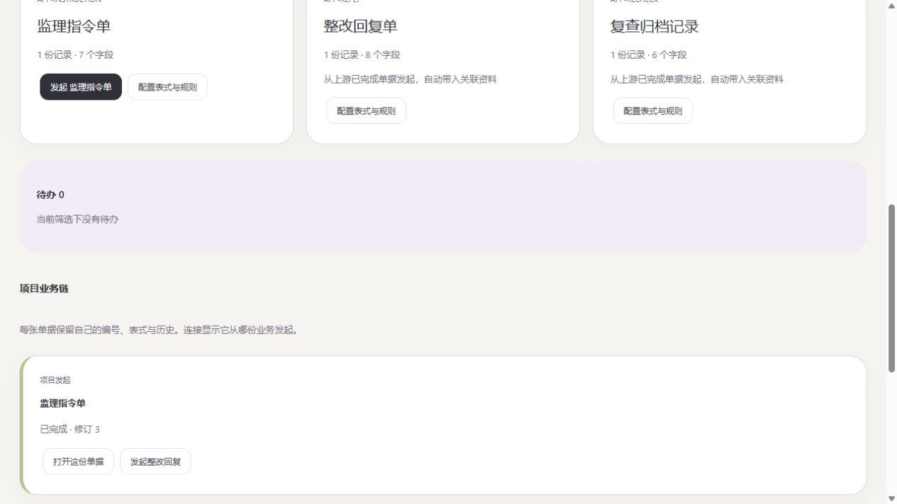

一张指令单发出去，施工单位拿它发起整改回复，监理复查后再形成归档记录。每张表都有自己的编号和办理历史，项目资料和上游内容可以直接带过来。

**1.3 已支持应用工作台、多项目、角色待办、跨表字段带入、可增删的明细行，以及确认后生效的自然语言规则草案。** 整套应用可以导出，换个浏览器恢复后继续办理。[本次更新与验收](docs/release-1.3.0.md)

[反馈卡住的步骤](https://github.com/hanxiaochi/FlowLens/issues/new?template=trial-feedback.yml) · [分享介绍与试用计划](docs/launch-kit.md)

[需求研究与下一阶段缺口](docs/fde-product-audit-2026-11-02.md) · [业务访谈与交付验收工作单](docs/fde-discovery-worksheet.md)

## 1.15 先把办理人安排好

管理后台会列出各项目的角色和启用成员，提醒哪些角色还没有承办人。点击项目可以定位授权，保存后保留当前选择。空白实例新增配置入口，应用缺少项目时给出补建说明。

125 项本地回归和 20 项独立运行包检查通过，正式候选正在进行最终验收。[本版说明](docs/release-1.15.0.md)

## 1.14 发布前，看清改了什么

上传更新包后，先核对字段、流程和表格布局的变化，再确认发布。多人同时改配置时，过期预览会要求重新核对。发布结果丢失后，可以用原请求继续确认，已有单据保留历史表式。

124 项本地回归与 19 项独立运行包检查通过，最终跨平台 CI 通过，云端五账号业务比对通过。[本版说明](docs/release-1.14.0.md)

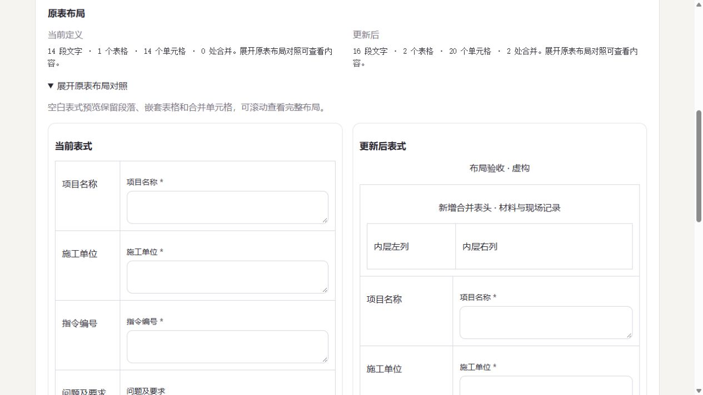

## 1.13 清单里显示什么，由你决定

在表式中点“配置清单摘要”，按顺序选择最多三个字段。编号、期限、检查要求可以直接出现在业务卡片上。本地台账、项目卡片与协作清单使用同一套配置，应用导出后也能带到团队服务。已有单据保留创建时的表式快照。

116 项回归及跨平台 CI 通过，配置、导出导入、存储失败与窄屏已有浏览器验收，云端已升级。[本版说明](docs/release-1.13.0.md)

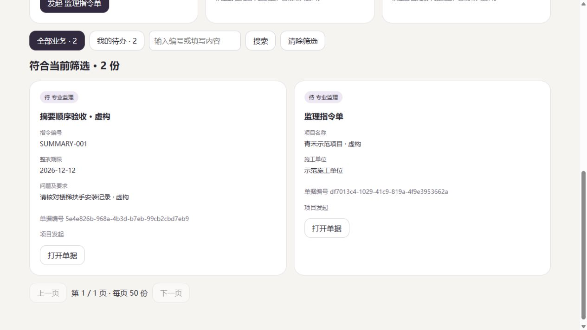

## 1.12.1 修正首次新建

修正了首次进入页面的新建按钮错误，以及无预填字段单据在修订 0 时不能保存本机草稿的问题。113 项本地回归通过。[修订说明](docs/release-1.12.1.md)

## 1.12 写到一半的内容，也能找回

业务卡片现在直接显示单据编号和字段摘要。填写文字、明细行与办理意见时，会保存本机草稿；刷新或重新登录后，从页头核对找回。两个页面各存一份，提交成功后只清理对应草稿。原修订变化时展示差异，供人工核对。

111 项回归、跨平台 CI，以及刷新恢复、多页面、权限变化和组合故障的浏览器验收已通过。云端已升级。[本版说明与保存范围](docs/release-1.12.0.md)

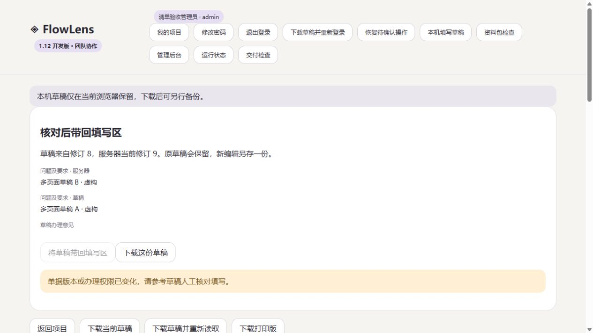

草稿保存在当前浏览器。清除网站数据会删除本机草稿，跨设备同步仍待实现。

## 1.11 刷新后继续确认上一次操作

业务操作先写入当前浏览器，再发送给服务器。断线或刷新后，用原账号登录“恢复待确认操作”，可以继续确认、下载原请求，或先查看项目。多标签页、重新登录、8 MiB 附件及存储失败已有实际验收，104 项回归通过。[使用范围与验收](docs/release-1.11.0.md)

恢复记录保存在当前浏览器。填写中尚未点击业务按钮的内容，可通过“下载当前草稿”保留。

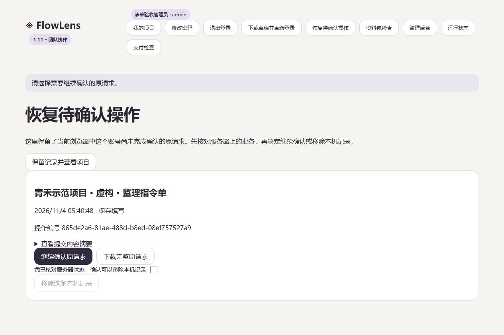


## 1.4 可以让团队一起办理了

1.4.1 修复团队经由代理访问时正常登录误触发限流的问题。Windows 和 Ubuntu 各通过 70 项回归，Linux 容器及 Compose/Caddy 已走通写入、备份恢复与 HTTPS 重新登录。每次相关代码更新会自动复验。[跨平台交付验收](https://github.com/hanxiaochi/FlowLens/actions/runs/41479752796)

发布后主分支补充了事务尾部写入失败的回滚重试测试，以及附件逐字节恢复检查，Windows、Ubuntu 各通过 71 项测试。[最新验收](https://github.com/hanxiaochi/FlowLens/actions/runs/41480784477) · [交付目标逐项审查](docs/delivery-plan.md)

Windows 内网试点已完成服务器本机的五账号 HTTPS 办理、恢复演练和浏览器页面复验，其他电脑访问与真实业务确认仍待验收。[试点进展](docs/delivery-plan.md)

随后已在所有者的腾讯云服务器完成公网 IP HTTPS、五角色办理、并发冲突及数据库恢复验收，并启用每日备份。真实业务试点与长期运行观察继续推进。[云端验收与截图](docs/cloud-pilot-2026-11-03.md)

1.10.2 补上断线后的业务重试保护。结果未确认时会保留原操作，避免再次点击按钮另建单据，并区分“业务已保存”和“清单刷新失败”。已通过浏览器故障注入验证。[修复范围与操作说明](docs/release-1.10.2.md)

1.10.1 优化了保存时的重复复制。相同的 500 份虚构业务测试中，两分钟持续保存从 283 次增加到 325 次，请求 P95 从 730 ms 降到 569 ms。94 项跨平台回归和云端五账号核对通过。[更新与测量边界](docs/release-1.10.1.md)

## 1.10 先找到单据，再打开办理

业务按项目分页，每页 50 份，可以按编号或填写内容搜索。待办数量覆盖整个项目，打开单据后再读取完整表式、明细和历史。归档后即使单据离开当前待办筛选，也能继续查看刚保存的结果。

Windows、Ubuntu 各通过 93 项回归，容器和云端五账号复验通过。500 份虚构业务的两分钟持续保存从 241 次增加到 283 次，持续请求 P95 略高，完整结果保留在验收记录中。[本版结果与边界](docs/release-1.10.0.md)

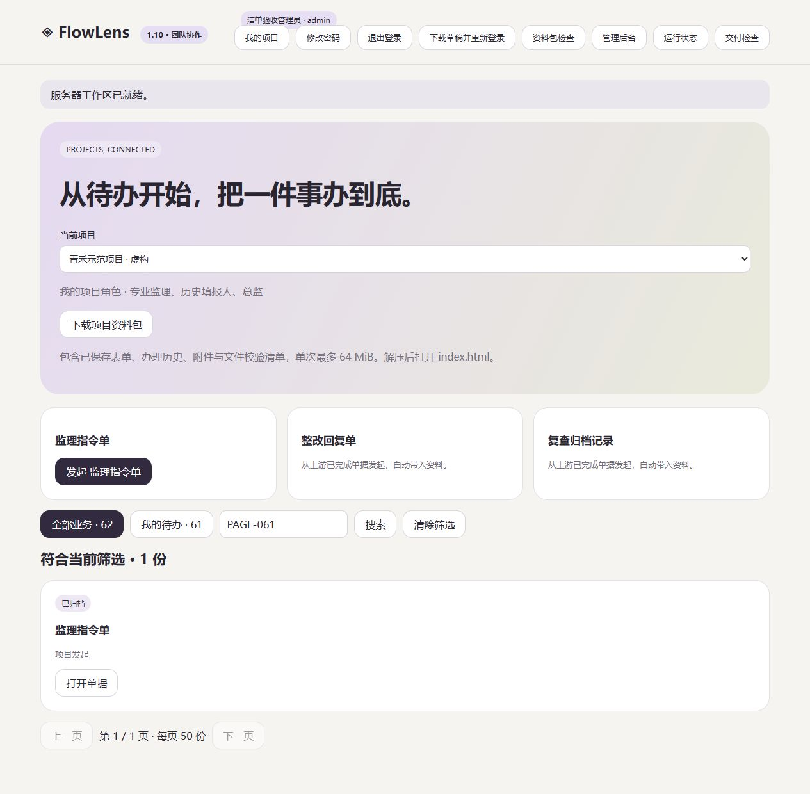

## 1.9 把资料恢复成能继续办理的项目

检查资料包后，填写新项目名称、安排成员，预览并确认恢复。系统会重建内部编号和单据关联，保留原填写内容与外部历史。断线后可以刷新页面、重选原 ZIP，继续同一次恢复。云端已验证原项目一致、附件下载、角色拒绝和恢复后继续办理。当前支持独立新项目恢复，已有项目合并另行推进。[使用范围与验收](docs/release-1.9.0.md)

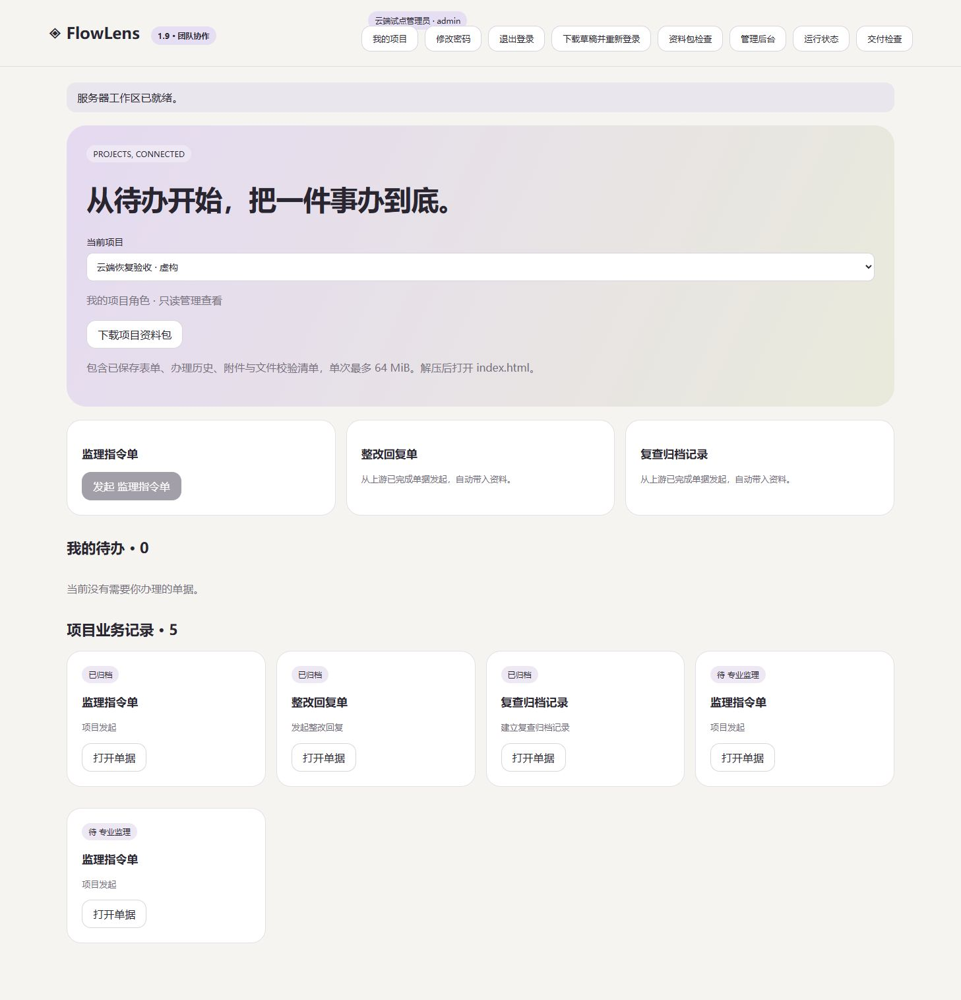

新增了 50／500 份虚构业务、24 MiB 附件的隔离并发基线。正确性、重试、重启和还原检查通过，500 份记录下的完整工作区刷新已出现明显延迟，下一步优化清单与明细读取。[测量环境、结果与边界](docs/capacity-baseline-2026-11-04.md)

## 1.8 收到资料，先检查一遍

管理员可以上传项目 ZIP，检查文件缺失、损坏、附件对应和单据关联，再查看当前实例的编号冲突、表式定义差异及待确认角色。报告能下载，换一个文件时会清除旧结果。Windows、Ubuntu 各通过 87 项测试，容器验收通过。本版提供检查与恢复预检，资料包恢复继续开发。[使用范围与验收](docs/release-1.8.0.md)

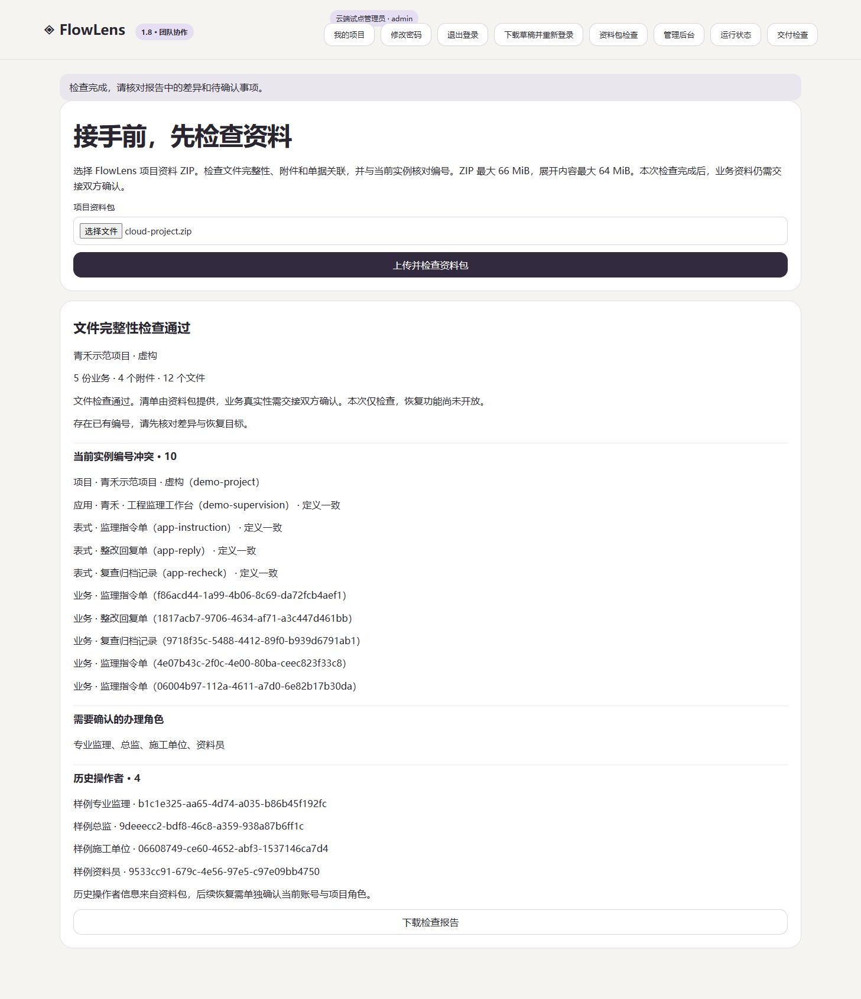

## 1.7 把一个项目的资料交出去

项目工作台可以直接下载资料 ZIP，里面有表单打印页、办理历史、关联记录、原始附件和 SHA256 校验清单。解压后从 index.html 找到要看的单据与附件。服务器按当前项目权限导出，单次上限 64 MiB，下载中断后可以重试。Windows、Ubuntu 及容器验收通过，82 项测试覆盖主要失败路径。[本版说明与待验收项](docs/release-1.7.0.md)

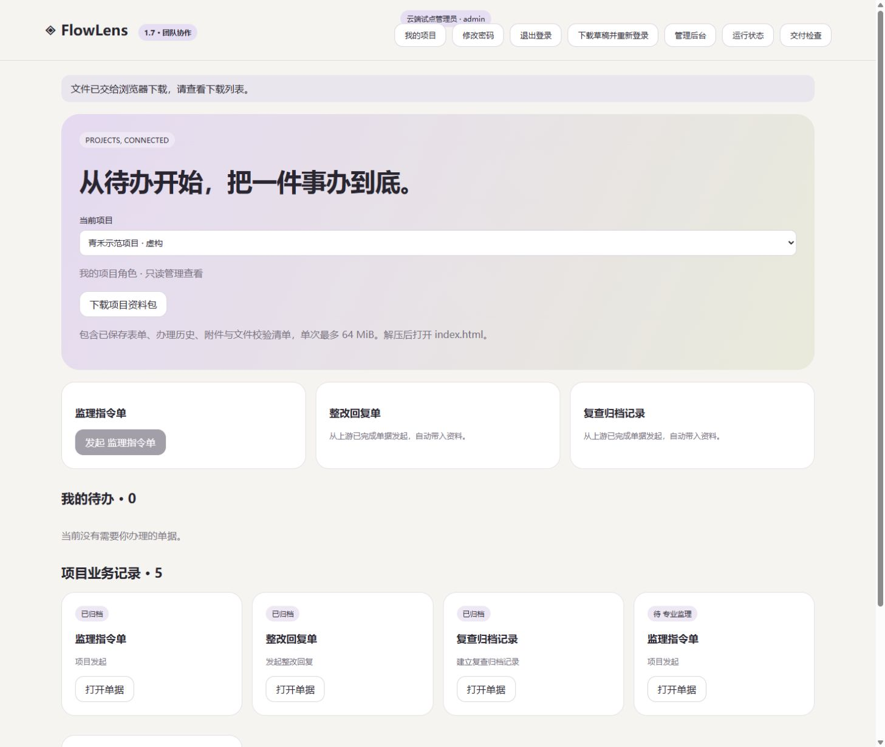

## 1.6 附件多了，也能继续办理

照片和扫描件现在独立存入数据库，打开项目时只读取附件信息，点击后再下载。下载可以取消，服务器会重新检查项目权限和文件完整性。旧数据自动迁移并保留迁移前快照，备份仍包含全部附件。云端已用三份 8 MiB 合成附件完成上传、下载及恢复核对，79 项自动化测试通过。实际容量与试点流程继续按项目验证。[升级与验收记录](docs/release-1.6.0.md)

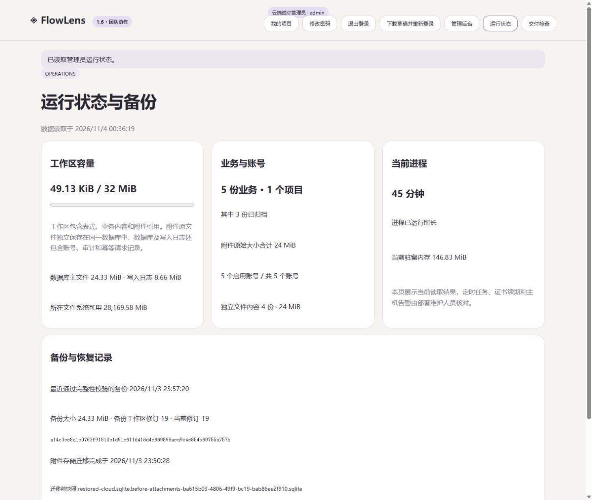

## 1.5 运行状态与交付检查

管理员现在可以查看数据容量、账号数量、备份校验记录和恢复时间。需要业务方确认的表式、职责及维护安排，也能按项目留下依据、记录人和历史。多人修改会检查修订与配置，恢复后提示重新核验。云端已完成备份升级，Windows、Ubuntu 各通过 73 项测试。[本版更新](docs/release-1.5.0.md) · [下一阶段计划与待确认项](docs/delivery-plan.md)

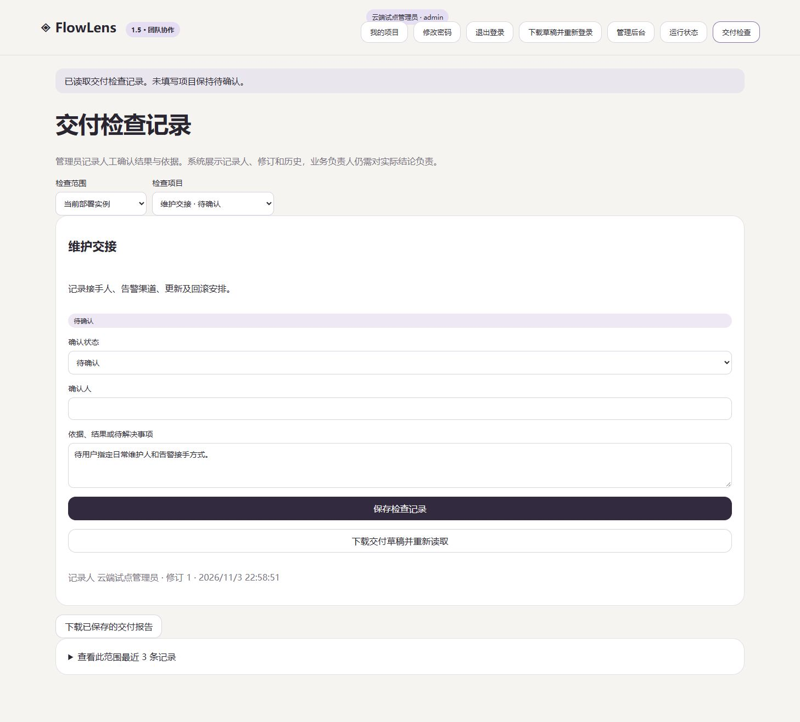

确认好表式和流程后，把整个应用包导入团队协作服务。管理员为不同项目分配账号和角色，监理发出指令，施工单位用自己的账号回复，资料员最后归档。记录、附件和实际操作者都保存在服务器里。

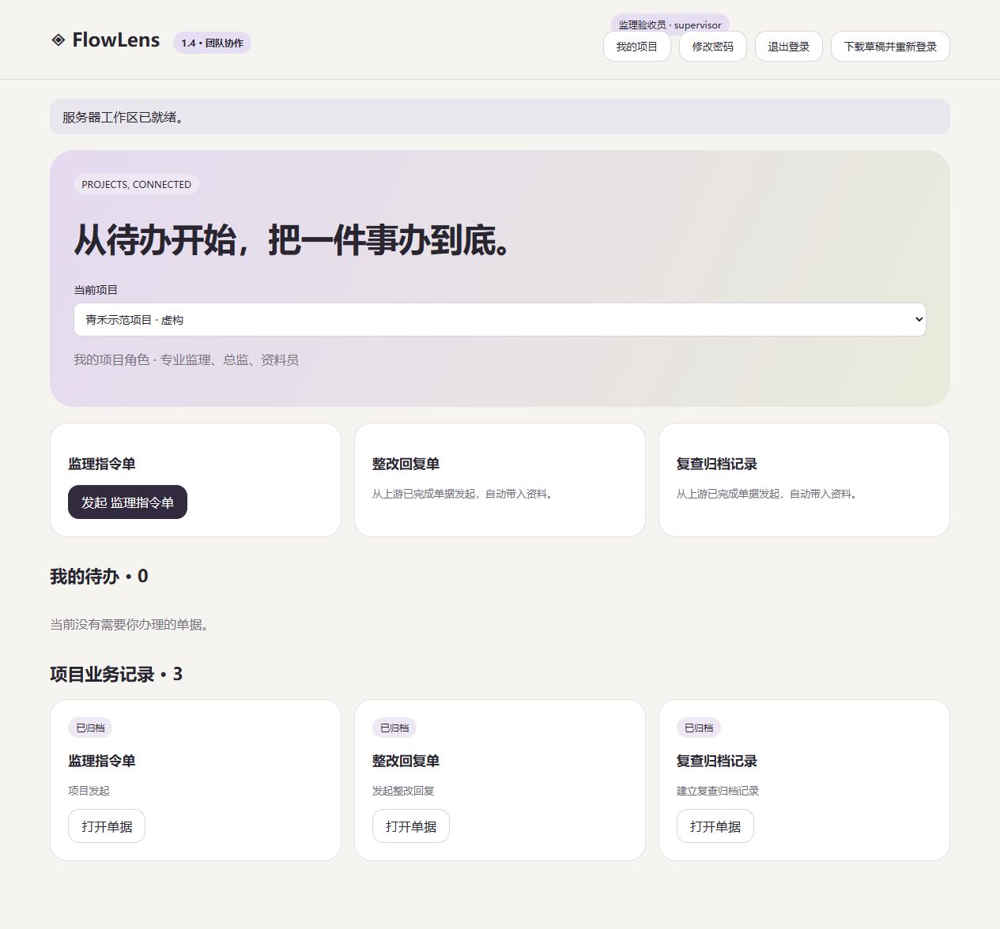

服务端会检查角色、阶段和修订号。重复请求复用原结果，过期页面不能覆盖新内容。新增了账号停用、密码修改、审计记录、表式版本发布，以及 SQLite 备份恢复工具。

下载发布页中的 `FlowLens-1.14.0-team.zip`，安装 Node.js 24 LTS，按部署指南初始化管理员后运行 `npm start`。协作包附带所需运行文件，可以离线启动。[部署与恢复指南](docs/team-deployment.md) · [本版验收](docs/release-1.13.0.md) · [持续交付计划](docs/delivery-plan.md)

公开 Demo 提供浏览器本地体验。团队服务需自托管，适合先用脱敏资料做小团队试运行。云端技术验收已有记录，真实客户流程、持续容量和维护交接仍需继续验证。

## 先看一遍怎么用

下方 1.3 设计工作台的三分钟演示从工程监理工作台开始，走过明细填写、指令与回复关联、退回重提、应用恢复和开发交付。

https://github.com/user-attachments/assets/38d1eb67-6578-40bb-aacc-599f04eefb60

**中文合成旁白与字幕，3 分 02 秒。** 视频使用实际操作中采集的页面画面，按步骤剪辑。演示数据均为虚构。

[观看 / 下载视频](https://github.com/hanxiaochi/FlowLens/releases/download/v1.3.0/FlowLens-1.3-guide.zh-CN.mp4) · [章节与文字稿](docs/video-guide.md) · [下载字幕](https://github.com/hanxiaochi/FlowLens/releases/download/v1.3.0/FlowLens-1.3-guide.zh-CN.srt)

有一个产品想法，却不知道该怎么跟开发讲清楚；画好了原型，又发现页面背后的权限、流程、数据库还没想明白。FlowLens 就是从这个问题开始做的。

你可以写一段需求，也可以上传一张原型截图。它会把想法整理成可以操作的页面，再把按钮背后的过程展开给你看：谁发起了请求、哪个模块处理、规则在哪里判断、数据最后怎么变化。

不懂开发也可以先试、先改，带着一个能演示的东西讨论。

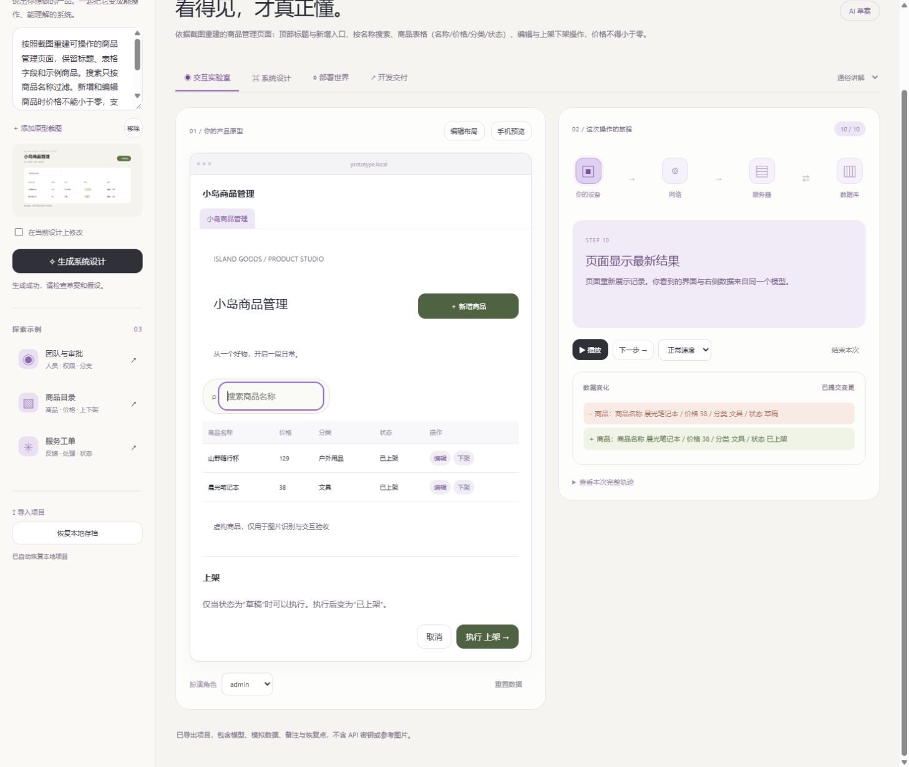

## 先玩起来

### 已有业务表格？从 Word 开始

管理工作往往已经写在一套表里。现在可以批量导入 DOCX，在保留合并单元格的原表结构中配置填写区，再把同一份记录交给下一位办理人。支持退回修改、审核、签发、签收、附件、关联单据及归档历史。

本地验收用四类监理资料导入了 340 份模板，并用复杂抽检表走完办理过程。模板识别不等于业务规则已经确认；字段和流程仍需核对。数据保存在当前浏览器，可导出工作包和独立打印版 HTML。这是本地流程推演，尚不提供多人认证、电子签章或生产服务。

[操作说明](docs/forms-guide.md) · [产品目标](docs/forms-roadmap.md) · [验收记录](docs/forms-acceptance.md)

### 想先体验系统原型？

没有 API Key 也没关系。内置了「团队与审批」「商品目录」「服务工单」三个例子，离线就能体验页面操作、流程推演和 3D 部署演示。

安装 [Node.js](https://nodejs.org/) 24 或更新的 LTS 版本，然后运行：

```sh
git clone https://github.com/hanxiaochi/FlowLens.git
cd FlowLens
npm ci
npm start
```

打开 [http://127.0.0.1:4173/](http://127.0.0.1:4173/)。

Windows 用户也可以双击 `启动 FlowLens.cmd`，首次启动会安装运行依赖。想省去这一步，可以到 [Releases](https://github.com/hanxiaochi/FlowLens/releases) 下载带运行依赖的压缩包，解压后双击启动。压缩包仍然需要安装 Node.js；内置样例不需要联网，AI 生成需要连接模型服务。

## 原型实验室也可以这样试

1. 选「团队与审批」，提交一条请假申请。
2. 跟着右侧的播放步骤，看请求如何经过检查、规则判断和数据写入。也可以一格一格往下走。
3. 换一个角色再操作，看看为什么有些按钮能点，有些会被拦下。
4. 到「系统设计」里，把请假天数的审批阈值改掉，再回到页面试一次。
5. 到「部署世界」里切到手机访问，或者模拟网络断开，看看请求停在哪里。

页面和图使用同一份模型。改了规则，下一次演示也会跟着变；数据写入发生在模拟执行过程中，不只是播放一段固定动画。

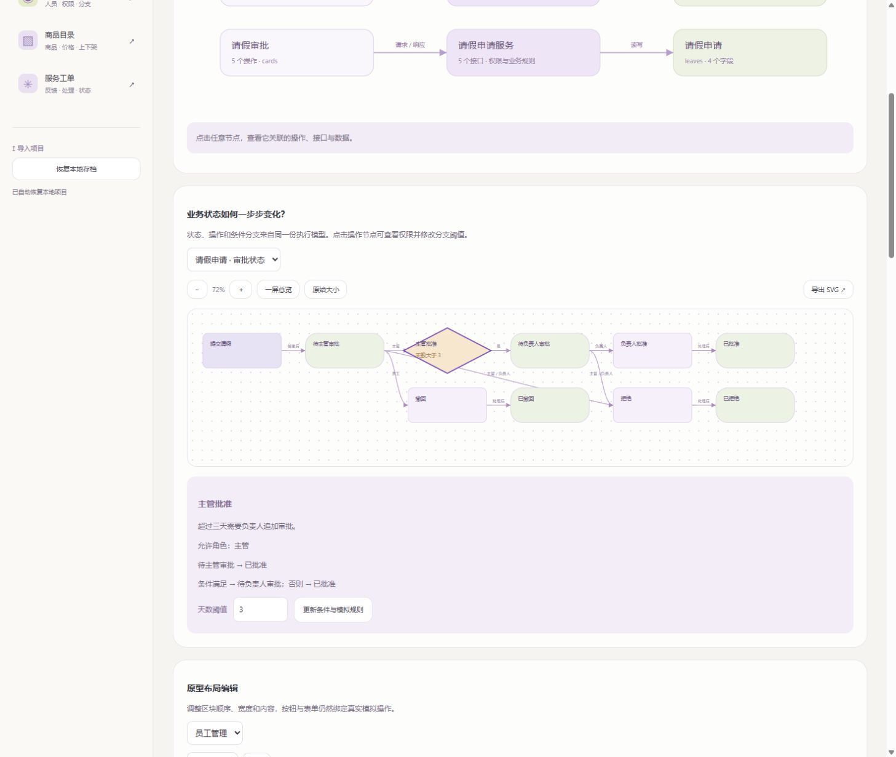

## 1.0 能做些什么

| 你想弄清楚的事 | 在 FlowLens 里怎么做 |
| --- | --- |
| 我的想法做出来是什么样？ | 自然语言或截图生成草案，编辑页面布局、字段与操作，预览手机页面 |
| 点这个按钮以后发生了什么？ | 逐步播放操作链路，查看角色权限、规则判断和数据前后对比 |
| 前端、后端、数据库怎么连？ | 查看模块关系、业务状态流程和实体关系图，导出 SVG |
| 服务器放在哪里？手机能不能用？ | 在 3D 场景里查看设备、网络入口、服务器、数据库，并模拟故障 |
| 下一步怎么交给开发？ | 导出项目 JSON、开发说明、OpenAPI 与 SQL 草案 |
| 改错了怎么办？ | 本地保存、恢复点、导入导出；应用 AI 修改前先看变更 |

## 把服务器也摆到眼前

服务器、数据库、网络入口不该只是几个陌生的名词。在 3D 场景里，你可以旋转、缩放、点选设备，跟着请求看看它们各自负责什么。

部署建议会参考使用人群、规模、移动端、预算、地区和维护能力。这里是在解释部署方案，不会替你购买云资源，也不会真的把应用上线。

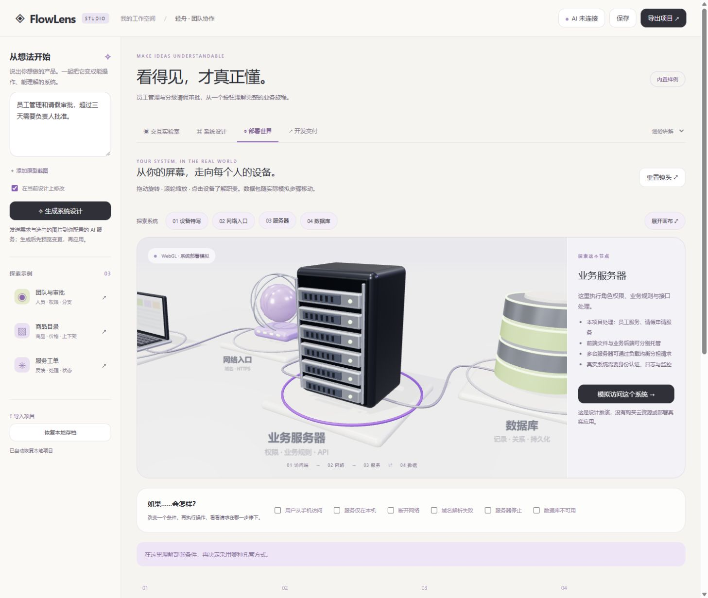

## 接上自己的 AI

点右上角「AI 连接」，填写服务地址、模型名称、协议和 API Key。目前支持兼容 **Chat Completions** 或 **Responses** 的接口。服务地址填接口基础地址，不要把 `/chat/completions` 或 `/responses` 重复填进去。

文字生成需要模型支持文字输入；截图生成还需要模型支持图片输入。支持的图片格式是 PNG、JPEG、WebP，单张不超过 5 MB。不是每个兼容接口、每个模型都具备相同能力，请以服务商提供的模型说明为准。

可以从这样的描述开始：

> 我想做一个员工管理和请假审批系统。员工能提交请假，主管可以审批，超过三天还需要负责人批准。首页显示员工列表和待审批事项。

生成后先检查页面、字段和假设。如果要继续修改，勾选「在当前设计上修改」，再描述变化。生成失败或取消时会保留原项目。

API Key 只保存在本机 Node 进程内存里，重启服务后需要重新填写。使用 AI 时，需求、选中的图片，以及修改时的当前设计会发送到你配置的模型服务。离线样例不调用模型。项目保存在当前浏览器里，重要内容请另外导出 JSON 备份。

## 目前的边界

FlowLens 支持业务建模、流程推演和单实例团队协作。具体交付范围以版本验收记录为准。

- 截图重建是近似布局，不能保证像素级还原；AI 推断出的业务规则需要人确认。
- 目前适合增删改查、角色权限、引用关系、状态流转和数值条件分支。复杂事务、任意代码逻辑、复杂日期计算不在当前范围内。
- 演示中的后端和数据库是模拟的。导出的接口与 SQL 是开发起点，团队服务已实现账号、项目权限、修订冲突保护及备份恢复，记录级权限和生产集成需按实际项目扩展。
- 团队服务支持多人分角色办理与共享持久化，工作台通过重新读取获取其他人的更新。项目内按记录保密和实时推送仍待扩展。
- 设计服务默认监听本机。团队服务的外部访问需要 HTTPS 反向代理和正确的源地址配置。3D 场景需要 WebGL。

## 想改代码的话

没有前端构建步骤，修改文件后刷新即可。

| 文件 | 主要负责什么 |
| --- | --- |
| `model.mjs` / `examples.mjs` | 统一模型、执行规则、数据校验与内置样例 |
| `studio.js` / `studio.css` | 工作台与交互界面 |
| `layout.mjs` / `layout-ui.js` | 原型布局及编辑 |
| `diagrams.mjs` / `diagrams-ui.js` | 系统关系与业务流程图 |
| `scene.js` / `deployment.mjs` | Three.js 场景与部署建议 |
| `server.mjs` | 本地静态服务及模型接口代理 |
| `export.mjs` / `impact.mjs` | 开发交付导出与修改影响分析 |

```sh
npm test
```

自动化测试覆盖模型校验、权限与状态转换、数据变更、布局、接口适配、超时取消、迁移及导出等场景。测试里的模型服务使用本地模拟接口，不消耗 API 额度，也不代表所有真实模型都能稳定生成正确结果。

3D 部分使用 [Three.js](https://threejs.org/)；SQL 验证测试使用 [PGlite](https://pglite.dev/)。依赖及许可说明见 [THIRD_PARTY_NOTICES.md](THIRD_PARTY_NOTICES.md)。

发现问题或有想法，欢迎开 [Issue](https://github.com/hanxiaochi/FlowLens/issues)。最好附上复现步骤和脱敏后的项目文件，别把密钥、真实客户数据一起贴上来。

## 开发进展

1.14 正在补齐表式发布的差异核对与恢复。服务端已提供只读预览和带基线检查的发布接口，核对账号、服务实例及更新包；相同操作编号重试会返回原结果，日常业务填写可以继续进行。

开发版界面已接入差异预览和浏览器恢复存储，124 项本地测试通过。复杂表式可展开前后布局，查看嵌套表格、合并单元格和列宽。浏览器已验证并发冲突、权限变化、存储配额不足、清理失败，以及发布成功后 API 中断再连接的恢复。390 像素视口下已核对布局。新界面使用带基线检查的发布接口，旧接口保留兼容行为。1.14.0 已发布，重新下载运行包的 19 项检查、公开 Demo 的 45 个文件核对及云端备份还原均通过。


1.15 开发版开始补齐启用前配置检查。管理员可以看到各项目无人承办的角色，并跳转到授权位置。已覆盖停用账号、历史角色与重复授权，125 项本地回归通过。空白实例已走通导入、补建两个项目、角色授权到首次新建业务。保存权限后保留当前项目，窄屏文件选择框已修正。独立运行包和成员入口继续验收，正式版为 1.14.0。
