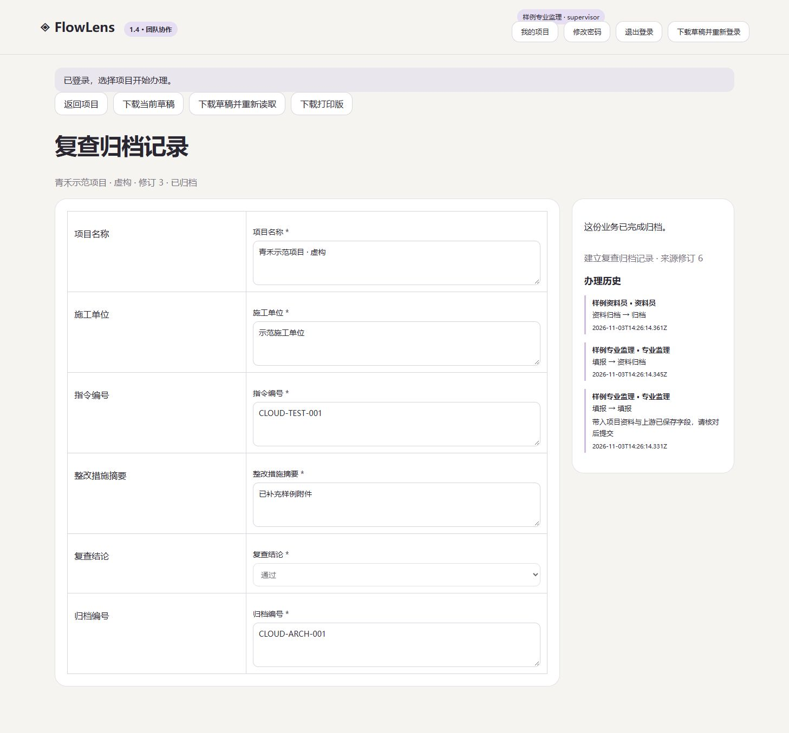

# 云服务器试点验收 · 2026-11-03

本次将 1.4.1 协作运行包部署到所有者的腾讯云轻量服务器，系统为 OpenCloudOS 9.6，规格为 4 核、4GB。旧项目按所有者要求停止，停止前备份源码、PostgreSQL 和文档卷，并保留原容器、镜像及数据卷。备份副本下载到所有者电脑后通过 SHA256 校验。

## 已执行的验收

| 项目 | 实际结果 |
| --- | --- |
| 公网 HTTPS | Let’s Encrypt 为公网 IP 签发短期证书，Windows 客户端按系统信任链和 IP SAN 校验通过 |
| 业务服务隔离 | 业务容器端口仅供 Docker 网络访问，网关对外提供 80 和 443 |
| 五角色办理 | 管理员、专业监理、总监、施工单位和资料员使用独立随机密码账号 |
| 完整流程 | 经公网完成指令签发、整改回复、退回、附件补充、重提、复查和归档 |
| 权限 | 施工账号访问管理接口和执行监理提交均被拒绝 |
| 并发写入 | 两个请求携带相同修订号，同时保存同一草稿，分别返回 200 和 409；成功请求重试返回原结果 |
| 恢复 | 在线备份后恢复至新数据库，重建业务容器并切换数据库；旧会话被拒绝，重新登录后的项目角色、记录及附件与恢复前一致 |
| 浏览器 | 经公网登录，核对项目角色、已归档记录、只读字段、归档编号及实际账号办理历史 |
| 日常备份 | systemd 定时器设为北京时间 03:15，附最多 120 秒随机延迟；首次手动执行成功，SQLite 完整性及 SHA256 校验通过 |
| 异地副本 | 当前备份已下载到所有者电脑并校验；后续每日任务生成服务器本地备份 |



## 资源与运行边界

业务容器限制 1 GiB 内存、1.5 CPU，网关限制 128 MiB、0.5 CPU。完成样例验收后的单次 `docker stats` 观察值为业务容器约 51.84 MiB，网关约 10.63 MiB。十个同时发起的已登录工作区读取全部成功，该次公网往返耗时为 24–1897 ms。这些数据仅描述本次小样本，持续负载、更多附件与长期增长需要另行测量。

Docker 已启用开机启动，容器采用 `unless-stopped`。已执行业务容器重建与数据库恢复，服务器整机重启尚未执行。证书首次签发已验证，后续完整自动续期周期仍需观察。备份当前全部保留，空间不足 512 MiB 时任务失败，备份保留周期和持续异地复制由维护方案确定。

真实业务负责人、适用表式、例外分支及维护交接仍待确认。当前云端仅使用虚构监理样例。

## 公网 IP 的 Caddy 配置

本次使用 Caddy 2.11.4、ACME `shortlived` profile，并为未发送 SNI 的 IP 客户端设置 `default_sni`。可将现有 Compose 的 `FLOWLENS_DOMAIN` 设置为自己的公网 IP，并将网关配置调整为下方内容。证书签发和续期需要可用的公网验证入口。

```caddyfile
{
    admin off
    default_sni {$FLOWLENS_DOMAIN}
}
https://{$FLOWLENS_DOMAIN} {
    tls {
        issuer acme {
            dir https://acme-v02.api.letsencrypt.org/directory
            profile shortlived
        }
    }
    reverse_proxy app:4186
}
```

使用前核对当前 Caddy 和证书机构对 ACME profile 与 IP 证书的支持。[Caddy TLS 配置](https://caddyserver.com/docs/caddyfile/directives/tls) · [Let’s Encrypt profiles](https://letsencrypt.org/docs/profiles)

## English summary

The owner-hosted 1.4.1 pilot passed public-IP HTTPS validation, five-account workflow execution, role rejection, concurrent-write conflict handling, browser checks, and restoration to a new database. A daily integrity-checked backup timer is enabled and its first manual execution succeeded. An off-host backup copy was downloaded and checksum-verified. Real-business approval, sustained capacity, a complete certificate renewal cycle, whole-host restart, and recurring off-host replication remain open acceptance items.
