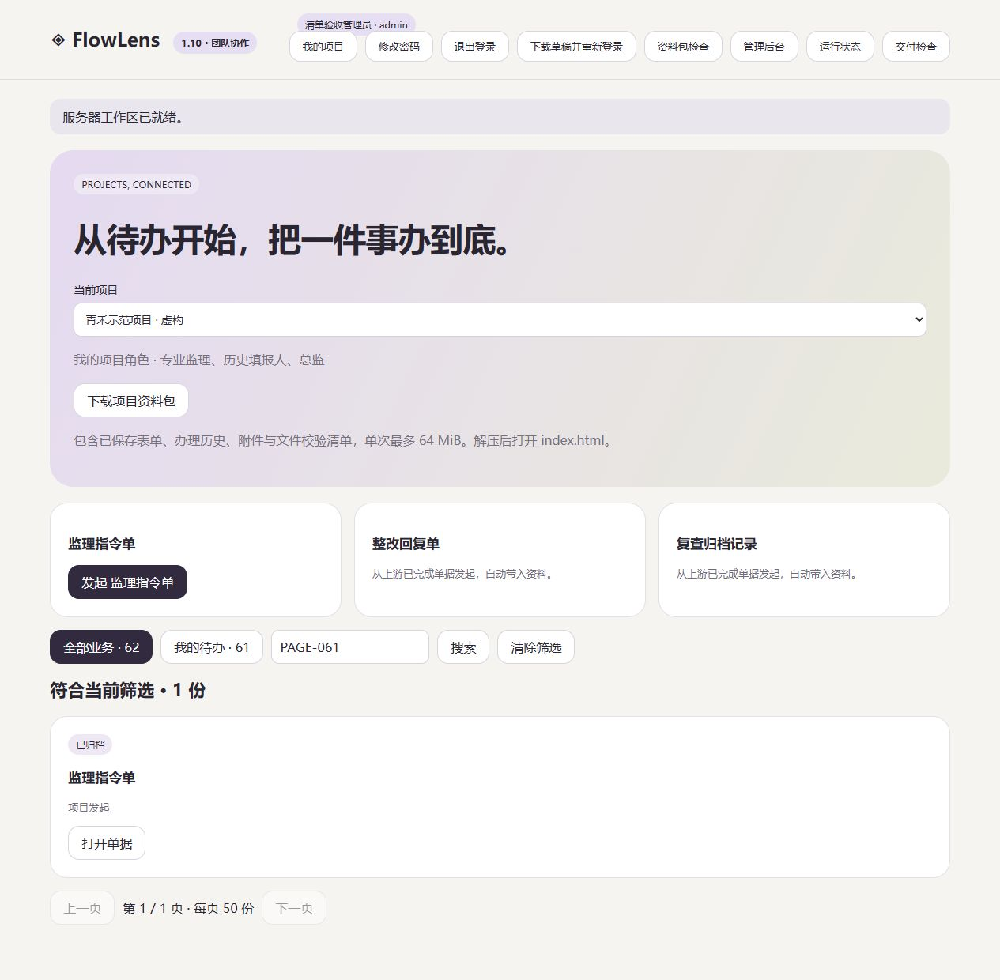
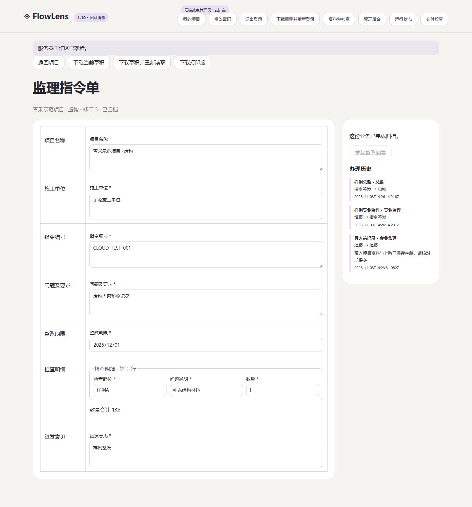

# FlowLens 1.10.0 · 分页与按需读取

2026-11-04

## 找到单据再办理

团队项目按每页 50 份展示业务，支持编号和填写内容搜索、全部业务与我的待办筛选。计数覆盖整个项目。打开单据时读取完整表式、明细、附件引用和历史，保存后的刷新同时带回当前单据，归档或筛选变化后仍能看到保存结果。历史角色授权覆盖项目全部记录。

## 验收

- Windows、Ubuntu 各通过 93 项回归，Linux 容器和 Compose 验收通过。[CI 记录](https://github.com/hanxiaochi/FlowLens/actions/runs/41703152165)
- 本地浏览器完成第二页历史角色办理、筛选外新建、保存及归档，下载打印文件包含编号、明细、意见与历史。
- 云端升级前建立一致性备份。五个账号的两项目、十份业务逐项与升级前匹配，完整旧协议、分页摘要、独立明细和合并读取均通过。
- 公网浏览器已显示 1.10 并打开既有归档单据。每日备份于 03:15 自动执行成功，本机副本哈希核对通过。

## 容量复测

相同的 500 份虚构业务、24 MiB 附件，服务限制 1 核 / 512 MiB，生成器 0.5 核 / 512 MiB。测量使用隔离容器内 HTTP。两个版本均以读取、保存、原请求重试、再读取组成四请求周期。

| 指标 | 1.9 | 1.10 |
| --- | --- | --- |
| 8 客户端完成 160 个周期 | 73.90 秒 | 64.08 秒 |
| 8 客户端请求 P95 | 1561.5 ms | 1515.9 ms |
| 导出与并行读取请求 P95 | 2925.2 ms | 1538.0 ms |
| 两分钟持续成功保存 | 241 次 | 283 次 |
| 持续操作请求 P95 | 688.0 ms | 730.3 ms |
| 服务进程峰值内存 | 286.7 MiB | 292.6 MiB |

持续吞吐增加约 17%，持续操作的请求 P95 略高。首轮六请求方案曾降低吞吐，保留其报告作为修正依据。两轮都通过修订计数、历史、冲突、幂等重试、附件哈希、重启及备份还原检查。所有容量测试使用虚构数据，公网网络和真实业务规模仍需单独验收。[复测数据](benchmarks/capacity-1.10.0-500.json)

在同一最终快照上，完整工作区响应模型约 2.89 MB，单页摘要约 20 KB，摘要加一份完整单据约 25 KB。具体大小随表式和历史增长。

## 交付范围

团队服务保持 SQLite schema 2，旧客户端读取协议继续支持。公开 Demo 保持浏览器内样例体验，在线 AI 关闭。团队协作需单独部署和账号授权。安装与备份步骤见[部署说明](team-deployment.md)。

真实业务负责人、表式职责、维护交接、长期运行、异地备份目的地、整机重启窗口和证书续期观察继续跟进。[交付清单与下一计划](delivery-plan.md)
