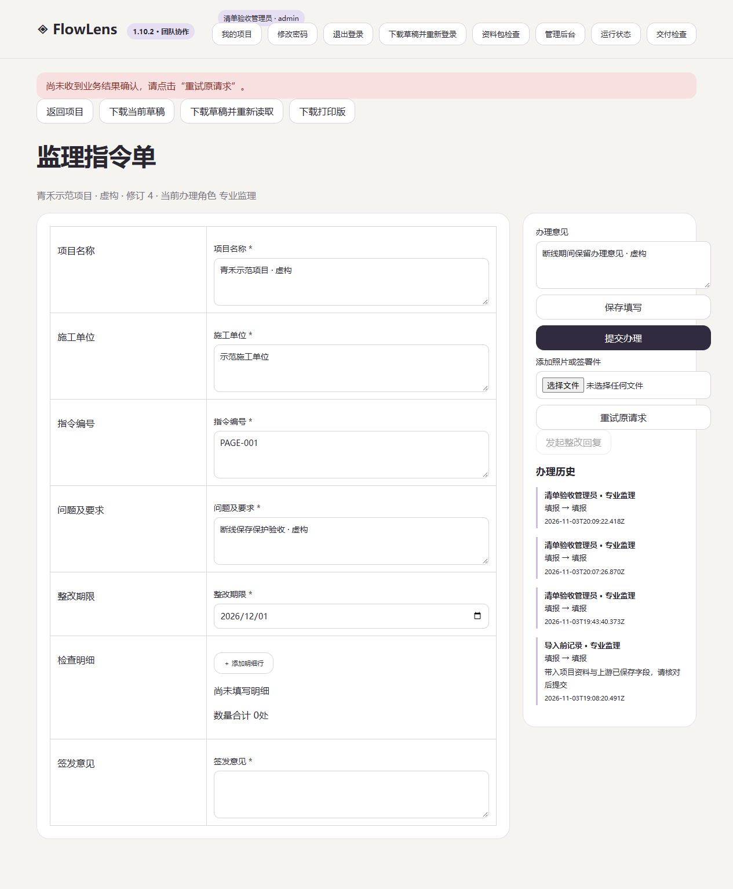

# FlowLens 1.10.2 · 业务重试保护

2026-11-04

服务器可能已经保存了业务，但网络没有把结果送回浏览器。本版在这种待确认状态下保留原操作编号。再次点击新建、保存或提交时，会提示先重试原请求。填写区与办理意见暂时锁定，确认原结果后恢复，避免重试时覆盖后来输入的内容。

提交已成功、随后清单读取失败时，页面显示已保存的单据，并明确提示清单刷新失败。

## 实际验收

隔离代理先让服务器提交成功，再丢弃响应。旧页面再次点击新建按钮会产生第二份单据，已复现这一问题。

修正后，同一场景中的再次点击被阻止，重试原请求只得到一份单据。另一个保存场景连续丢失两次成功响应，最终重试后修订只增加一次，填写值与历史正确。待确认时填写区和办理意见锁定，成功后恢复。单独注入提交后的清单 503，页面显示“业务已保存”，并保留新单据。

94 项自动化回归通过，浏览器异常路径另有上述故障注入验收。云端升级前已建立备份，五账号的两项目、十份业务与升级前匹配，公网页面显示 1.10.2。

## 当前范围

待确认保护适用于当前打开的页面。普通业务跨刷新恢复、持久草稿和请求超时继续推进。页面提示结果待确认时，请使用“重试原请求”，或先下载草稿再读取服务器状态。[后续计划与待确认事项](delivery-plan.md)

本版保留 1.10.1 的保存性能改进。性能测量和真实规模边界见[上一修订版](release-1.10.1.md)。数据库 schema 仍为 2。

[跨平台验收记录](https://github.com/hanxiaochi/FlowLens/actions/runs/41710265712)
