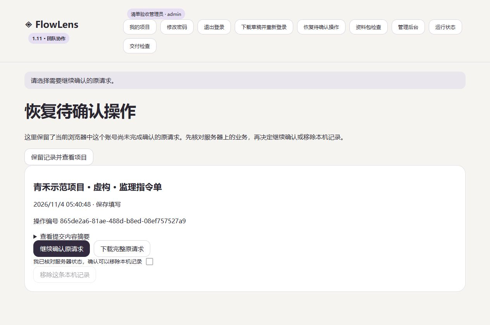

# FlowLens 1.11.0 · 刷新后继续确认业务

2026-11-04

点击新建、保存、提交、退回、继续办理或上传附件后，FlowLens 先把原操作写入当前浏览器，再发送给服务器。断线或刷新后，用原账号登录，可以从“恢复待确认操作”继续确认。

## 操作结果如何确认

恢复记录保留原操作编号、提交内容、账号、服务实例和新建时的表式版本。服务器继续按当前权限核验。已提交的请求复用原结果，同一业务在多个标签页的待确认操作受到存储约束。

普通请求的客户端超时为 30 秒，附件上传、应用导入和表式发布为 120 秒。超时、代理 5xx 或无法解析的响应会保留待确认状态。明确的字段校验拒绝后，可以继续修改填写内容。服务器已保存但本机清理失败时，页面会说明业务已保存，并保留确认入口。

服务实例、账号或表式不匹配时，需要先核对当前业务。恢复页提供原请求下载和“保留记录并查看项目”。手动移除本机记录需要勾选已核对服务器状态。

## 数据保存范围

恢复记录保存在当前浏览器的站点数据中，包含提交值、办理意见和待上传附件。成功确认后自动清理，完整原请求下载文件包含这些内容。清理浏览器站点数据会移除本机恢复记录。

恢复范围从点击业务按钮、成功写入本机开始。填写中内容可通过“下载当前草稿”导出，离开页面时继续提示未保存内容。跨浏览器、跨设备的草稿同步仍需后续实现。

## 验收

104 项本地回归通过，Windows、Ubuntu、容器和 Compose 验收通过。[CI 记录](https://github.com/hanxiaochi/FlowLens/actions/runs/41723812833)

隔离浏览器故障注入已验证跨刷新恢复、两个标签页竞争、会话失效后重新登录、换账号列表隔离、配额失败时零业务请求、本机清理失败，以及明确校验拒绝后的可编辑状态。8 MiB 附件刷新恢复后修订只增加一次，实际下载文件的 SHA256 与原件相同。

独立数据库还原副本使旧会话失效，原账号重新登录后，旧环境请求在页面中被禁用，接口返回 409，业务与审计没有变化。原库和还原副本保留。

云端已备份升级。五个账号的两项目、十业务与升级前核对一致，错误账号和实例请求被拒绝，受绑定保护的正常保存及原请求重试通过，其他九份业务保持一致。公网浏览器已验证恢复入口。

数据库 schema 保持 2。升级后保存当前填写内容并刷新页面，进入新版恢复流程。真实业务职责、长期试点、维护交接和异地备份安排继续验收。[部署与恢复说明](team-deployment.md) · [后续目标与待确认项](delivery-plan.md)
