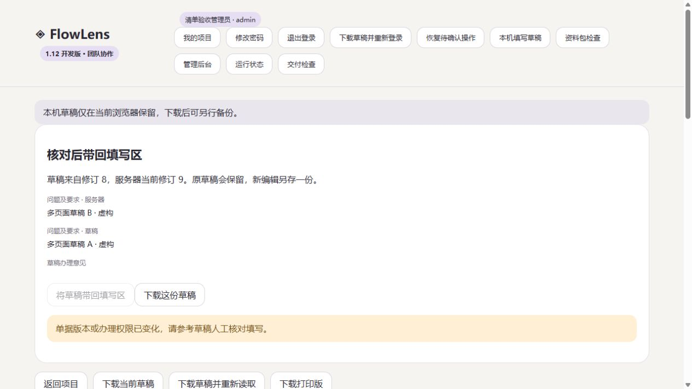

# FlowLens 1.12.0 · 填写草稿与业务摘要

2026-11-04

请使用 [1.12.1 修订版](https://github.com/hanxiaochi/FlowLens/releases/tag/v1.12.1)。1.12.0 的首次新建入口与修订 0 草稿存在问题，修订版已修正并补充回归验收。

同一项目里常常有很多同名表单。业务清单现在会显示单据编号，以及前三个非空字段的简短内容，方便找到要办理的那一份。摘要使用单据自己的表式快照，长内容截短，明细表显示行数。

## 写到一半也能找回

填写文字、增删明细行或写办理意见时，FlowLens 会把草稿保存到当前浏览器，并显示保存状态。刷新或重新登录后，从页头“本机填写草稿”查看。每个编辑页面单独保存，两页同时填写同一单据时，两份草稿分别保留。

核对入口会读取服务器单据，展示原修订、当前修订及填写差异。身份、环境、修订和办理权限相符时，可以将草稿带回可编辑字段。原备份继续保留，新编辑另存一份。修订或权限变化时，需要人工核对填写。

保存业务成功后，只清理此次提交关联的草稿版本。遇到断线、结果丢失或本机清理失败，继续使用“恢复待确认操作”确认原请求。每次重试保留原操作编号。

## 保存范围

本机草稿包含填写内容、办理意见和字段定义。它保存在当前浏览器的站点数据中，按登录账号显示，清除网站数据会删除。已保存的个人草稿在失去项目权限后仍可下载，服务器读取与写入继续按当前权限执行。跨浏览器、跨设备的草稿同步尚未实现。

“本机草稿已保存”表示当前浏览器已完成写入。业务数据仍需点击保存或提交后写入服务器。存储失败时保留当前输入，并提供下载草稿入口。未提交编辑的离页提醒继续保留。

## 验收

111 项本地测试通过，Windows、Ubuntu、容器和 Compose CI 通过。[CI 记录](https://github.com/hanxiaochi/FlowLens/actions/runs/41732094845)

独立运行包通过 15 项交付检查，覆盖权限、摘要、并发、幂等、资料包、备份还原、实例变化及草稿模块的实际提供。

浏览器验证了刷新后找回、普通字段和明细恢复、两个页面分别编辑、对应版本清理、旧修订拦截、换账号隔离、撤权后的读取拒绝、存储配额失败和草稿下载。组合注入业务结果丢失与草稿清理失败，跨两次刷新确认后只有一次业务修订，两类本机记录均清理成功。

独立还原副本使原会话失效，旧环境草稿入口被禁用，两库 76 份虚构业务的 workspace 哈希一致。390 像素视口的业务摘要清单没有横向溢出。

云端已备份升级至 1.12.0。五个账号读取的两项目、十业务与升级前一致，摘要与完整单据逐项核对通过，公网浏览器已检查新版摘要和草稿入口。最终发行下载与备份核验记录持续写入交付计划。真实表式和职责、长期试点、运维交接及异地备份安排继续列为待确认事项。[部署说明](team-deployment.md) · [持续推进计划](delivery-plan.md)
