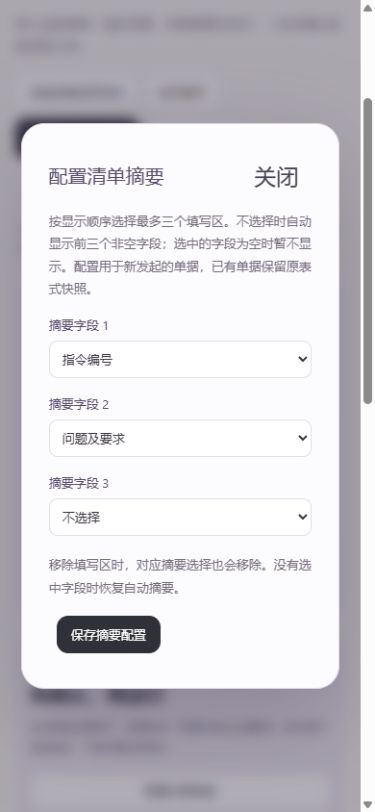
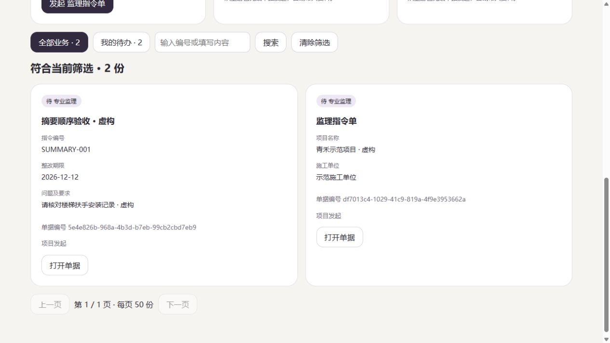

# FlowLens 1.13.0 · 让清单显示你关心的字段

2026-11-04

同名表单多起来以后，按编号、部位或期限寻找单据更方便。这一版可以由表式设计者选择清单摘要，例如先显示指令编号，再显示整改期限和检查要求。

## 在表式中选择摘要

打开表式配置，点击“配置清单摘要”，按显示顺序选择最多三个填写区。不选择时继续自动显示前三个非空字段。选中的字段为空时暂不显示，其他字段不会自动补位。

重复字段会在对话框内提示。保存失败时保留当前选择，可以重试；保存相同配置不会增加表式版本。移除填写区时，对应的摘要选择也会移除。编辑已有填写区会保留其原先顺序。

## 从设计工作台带到协作服务

本地业务台账、项目业务卡片和团队清单使用同一套摘要逻辑。应用包会带上摘要配置，可以通过协作管理后台导入或发布新版表式。

新单据保存创建时的表式快照。旧单据继续按自己的快照显示，便于回看当时采用的规则。字段名称和内容都有长度限制，布尔值显示“是/否”，明细表显示行数。完整内容仍在原单据中。

## 验收

116 项本地回归通过，独立运行包通过 17 项交付检查。配置顺序、空值、重复及不存在字段、旧工作包、新旧快照、表式发布、资料包还原和继续办理均已纳入检查。

浏览器已走通配置摘要、新建填写、导出整个应用、导入隔离协作服务并显示同样摘要的流程。存储失败时选择保留，重试后只增加一次表式版本；再次保存相同配置不增加版本。

390 像素视口下，配置对话框和长摘要没有横向溢出。显示摘要为 120 个 Unicode 字符加省略号，原单据仍保留完整的 270 个字符。验收使用虚构业务数据。

数据库 schema 保持 2。Windows、Ubuntu、容器和 Compose CI 已通过。[CI 记录](https://github.com/hanxiaochi/FlowLens/actions/runs/41738190719)

云端已备份升级至 1.13.0，五账号读取的两项目、十业务与升级前一致，公网浏览器已确认登录和清单显示。发行下载和最终备份核验继续记录在[交付计划](delivery-plan.md)。实际表式、职责和长期试点仍需业务负责人确认。[部署说明](team-deployment.md)
