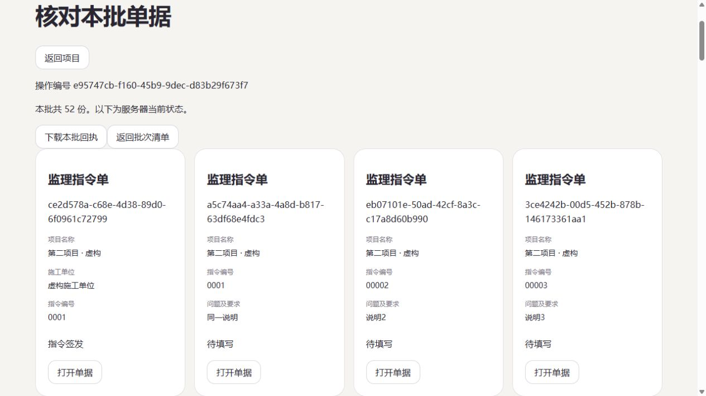

# FlowLens 1.17.0 · 导入以后，找得到每一份单据

项目首页新增“导入批次历史”。不用留着导入完成页面，也能找回之前的一批单据：谁导入的、导入了多少份、现在办到了哪一步。

## 按批次核对

批次清单和单据详情每页最多 50 条。详情沿用单据自己的表式摘要，显示填写内容与当前办理阶段。打开一份单据再返回，会回到原来的批次页。下载回执会重新核对当前项目权限。

1.16 产生的回执可以直接查询。旧版没有记录导入时间，页面会如实说明；旧回执的姓名来自当前账号，新回执保存导入时的姓名和时间。历史清单按写入顺序排列，不猜填日期。

## 数据与权限

查询使用已有服务端回执，不重新导入业务，也不修改历史单据。管理员可查看项目批次，普通成员需要当前项目角色。撤销角色或停用账号后，新查询会被拒绝。完整实例备份还原保留历史回执，但旧实例请求仍不可重放。项目资料 ZIP 不包含实例请求回执，转入另一实例不会带入批次清单。

## 验收记录

138 项本地回归通过，包含批次分页、52 份单据分页、旧回执、HTTP 权限撤销与实际 CLI 备份还原。浏览器验证已有三批历史、当前办理阶段、第二页单据往返及回执下载；52 个编号与原回执完全一致。390 像素视口下页面宽度与滚动宽度均为 375。独立候选运行包的 22 项检查通过。

最终跨平台 CI、云端五账号数据比对及备份恢复已通过。发行下载证据在[交付计划](delivery-plan.md)补齐。业务样例为虚构数据，真实表式职责及试点验收仍需业务负责人确认。
