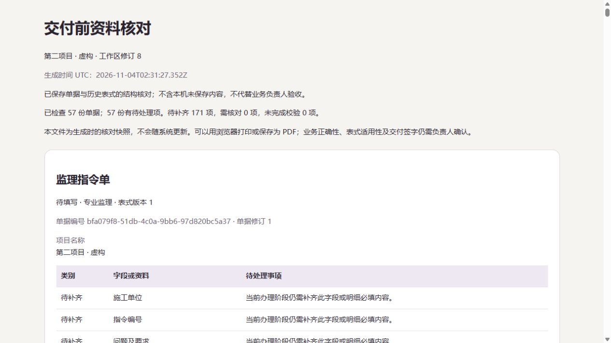

# FlowLens 1.19.0-rc.1 · 交付前先把资料核对一遍

这是候选版，用于试用资料核对功能。正式版、公开演示站和云端仍为 1.18.0。打印分页尚未完成实机验收，当前不建议把候选版核对清单当作已验收的正式打印交付件。

## 这版能做什么

项目工作台新增“交付前资料核对”。它按每份单据实际使用的历史表式，检查当前阶段待补内容、已办理资料的异常、上游关联和附件完整性。未来阶段还没轮到填写的空项，不会直接报成当前缺项。

可以按问题类别、编号或业务摘要搜索，也可以只看自己的项目角色能办理的单据。打开单据再返回，会保留筛选和页码。全项目统计和筛选结果分别显示，下载清单始终包含全项目最新核对结果。

附件每轮最多校验 64 MiB。超出部分会写明“未完成校验”，可以单独校验并下载。下载不会偷偷把旧快照改成通过。HTML 清单可离线阅读，记录项目、生成时间、工作区与单据修订，不会随着系统变化而更新。

## 已验证与边界

- 155 项本地测试通过，覆盖历史表式、退回重提、跨项目隔离、权限撤销、附件损坏与容量边界。
- 候选版本提交 b6668da 的 Windows、Ubuntu、容器 CI 41763846731 全部通过。
- 最新开发运行包通过 24 项独立检查，包括并发冲突、重复请求、项目恢复和数据库备份还原。
- 浏览器已验证分页返回、筛选保留、390 像素视口操作、单独附件下载及筛选为空时完整项目下载。
- 400 份单据、40000 项问题的样例验证超大整份报告返回明确限制，分页仍可使用。

以上使用隔离虚构资料。真实表式、职责和交付签字仍需要业务负责人确认。GitHub 下载后的候选协作包 SHA256 一致，24 项独立运行检查通过。打印分页和正式云端升级尚未完成，不用自动测试结果代替这些验收。

## English

This release candidate adds a project review checklist: required fields by workflow stage, historical form checks, upstream references, and attachment integrity. Search and issue filters run before pagination; the role filter uses actual project assignments. Downloads always contain the full project review, even when the screen is filtered.

The checklist is a timestamped, read-only snapshot. Attachment verification is capped at 64 MiB per report, with remaining files explicitly marked unchecked and available for individual verification/download. It does not replace business sign-off.

155 local tests and the code-level Windows/Ubuntu/container checks passed. Browser interaction and narrow-screen checks passed on fictional fixtures. The published team ZIP was downloaded again, matched its SHA256, and passed 24 independent runtime checks. Printed pagination and final stable release/deployment acceptance remain pending. The stable cloud service and public demo remain on 1.18.0.

## 目标主机隔离补验

候选镜像已在云服务器上使用 1.18 备份副本完成隔离检查：5 个账号、2 个项目、10 份单据、4 个附件及 10 次项目核对通过，备份再还原后的工作区一致。容器无网络、无对外端口，正式服务未升级。只读来源恢复存在 SQLite 旁文件限制，暂用经校验的可写副本，见部署说明；该限制的工具改进仍待完成。
