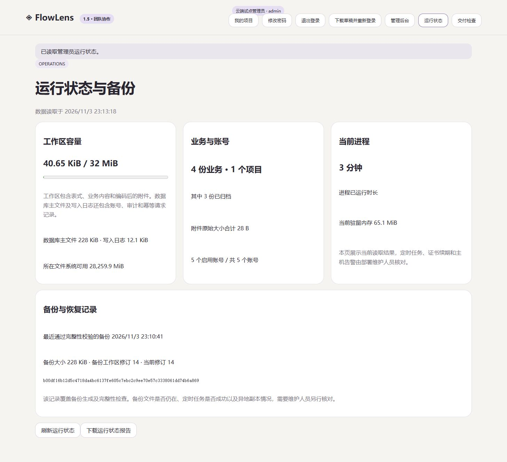
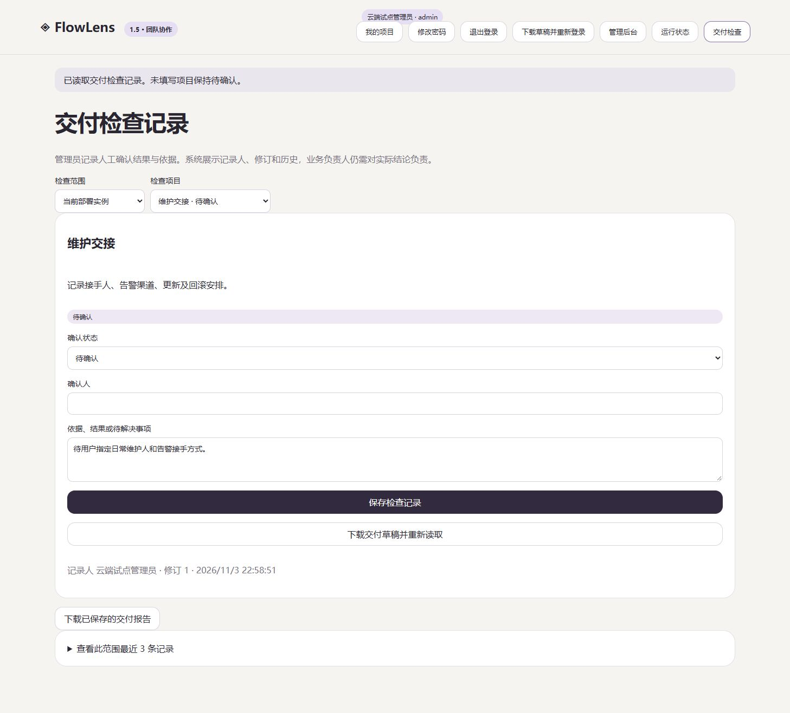

# FlowLens 1.5.0

这次把运行维护和交付检查放进了团队工作台。管理员可以查看数据用量、备份记录，也可以把尚未确认的事情留下来，带着依据交给下一位接手人。

## 运行状态

- 工作区用量和 32 MiB 上限，达到 80% 时提醒评估容量。
- 数据库主文件、WAL、文件系统可用空间、附件原始大小与账号数量。
- 进程运行时间及驻留内存。
- 最近通过完整性检查的备份时间、大小、工作区修订和 SHA256。
- 恢复标记与可下载的 JSON 状态报告。

备份工具在生成一致性快照后检查 SQLite 完整性并计算校验值。恢复后清除旧实例的维护状态，记录本次恢复时间。页面反映工具记录的结果，备份文件保管、定时任务运行和异地副本仍由维护流程核对。

## 交付检查

实例清单包含 HTTPS、备份恢复、异地备份、主机重启和维护交接。每个项目分别记录表式、人员权限及业务流程确认。

每条检查有状态、确认人、依据、实际登录记录人和修订历史。标记通过或待解决时必须填写确认人和依据。多人修改发生冲突时保留草稿，重复请求复用原结果。服务端同时校验填写时的配置版本，防止将旧页面的结论应用到已变化的配置。

项目表式或成员配置变化后，原来的通过项显示为“需要重新核验”。实例地址变化或数据库恢复也会触发相应复核，原确认依据和历史保留。检查结果由管理员登记，业务方负责实际确认。每个范围可导出已保存报告，页面和报告展示最近 200 条历史记录。

## 验收

Windows、Ubuntu 各通过 73 项测试，Linux 容器及 Compose 验收通过。测试覆盖权限、备份校验、老数据库兼容、恢复后复核、检查记录并发、重试、失败回滚、配置变更及操作者归属。[CI 运行](https://github.com/hanxiaochi/FlowLens/actions/runs/41660537370)

本机浏览器完成检查项填写、未保存离开保护、保存、历史展开及报告下载。云端已备份后升级，升级前后四份业务记录、项目角色和附件核对一致，管理员新入口和普通成员拒绝访问已验证。四项待确认事项已写入云端清单。

## 升级与下载

先执行一致性备份，保留原程序与部署配置，再切换新程序。启动时新增维护和交付检查数据表，原业务数据沿用。升级后核对记录数、角色、附件、备份记录及交付检查。旧版程序生成的备份没有维护记录时，页面显示暂无记录，需要用新版工具执行一次备份。

- `FlowLens-1.5.0-team.zip` 独立协作服务，要求 Node.js 24+。
- `FlowLens-1.5.0-source.zip` 源码与测试。
- `FlowLens-1.5.0-local.zip` 带运行依赖的本地设计工作台与协作源码。
- `FlowLens-1.5.0-public-demo.zip` 静态公开体验。
- `SHA256SUMS.txt` 发布文件校验值。

README 的视频继续展示 1.3 设计工作台。本次协作管理能力以截图和操作说明介绍。真实业务负责人、表式、维护安排及长期运行验证仍按待确认清单推进。

## English

Version 1.5 adds an admin operations page and delivery check records. Capacity, account and record counts, verified backup metadata, and restore markers are visible and exportable. Instance and project checklists retain reviewers, evidence, actual recording accounts, revisions, and history.

Stale writes and changed configuration are rejected. Successful checks require review again after relevant configuration changes or restoration. Windows and Ubuntu each pass 73 tests, with Linux container and Compose acceptance passing. The owner-hosted cloud service was backed up and upgraded, and its existing records, roles, and attachments matched the pre-upgrade snapshot.

Use Node.js 24 or later. Back up before upgrading. Business approvals and longer-term operating evidence remain pending. README videos continue to cover the 1.3 design workspace.
