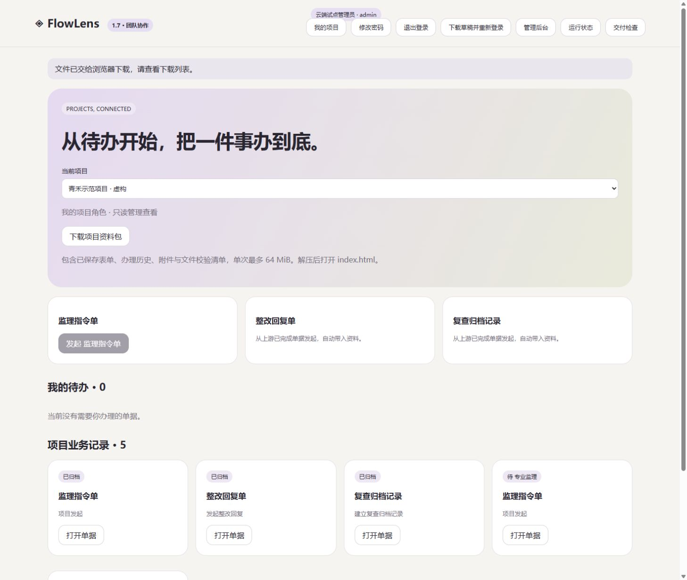

# FlowLens 1.7.0 · 项目资料交接

2026-11-04

项目办完了，资料也应该能带走。团队工作台现在可以按项目下载一个 ZIP，把表单、办理历史和附件放在一起，交给接手的人核对。

## 资料包里有什么

- index.html 提供项目索引和文件链接，完整解压后打开。
- forms 目录保存每份已保存单据的打印页，包含办理历史。
- attachments 目录保存原始附件，内部编号避免重名和路径冲突，索引保留原名称。
- project.json 保存项目、应用、表式快照、单据关联和记录。
- manifest.json 列出其余文件的大小和 SHA256，便于核对传输完整性。

服务器核对当前账号和项目权限，使用一致的数据库读取快照生成资料。撤销成员权限后无法继续发起导出，附件损坏会使整份导出失败。单次内容上限为 64 MiB，每个进程同时发送一份资料包。下载支持取消，连接中断后释放发送名额。

## 已完成的技术检查

Windows、Ubuntu 各通过 82 项自动化测试，容器与 Compose 验收通过，包含项目隔离、停用账号、撤销成员、同名附件、危险文件名与 HTML 字符、文件校验、超限拒绝及下载中断后重试。独立协作运行包也覆盖项目导出。

Windows / Node.js 24.17.0 的合成样例包含三份 8 MiB 附件，导出为 25,214,863 字节，一次耗时约 82 ms，进程峰值约 198 MiB。此测量用于观察当前实现，实际负载仍需按项目验证。

本机浏览器从正常入口下载 ZIP，解包后逐文件校验值和附件字节一致。内置浏览器限制打开 file://，离线页面的实际视觉验收保留为 Q01 待确认。

云端已备份升级。公开 HTTPS 接口及浏览器均下载了包含 5 份业务、4 个附件的项目包，11 个清单文件的大小与 SHA256 全部一致，单据内容、办理历史和关联信息与服务器快照一致。接口测得 25,291,899 字节下载耗时约 70 秒，工作区保持原修订。

## 使用边界与升级

资料包用于阅读和交接。恢复服务继续使用管理员数据库备份，资料包导入、编号冲突预检和账号映射另行实现。SHA256 清单可检测内容变化，清单本身需要交接双方核对。项目成员可读取本项目全部业务，账号分配应按实际职责确认。

数据库结构继续使用版本 2。从 1.6 升级前先做备份，保留旧程序，再替换运行包并重启。更早版本先阅读 1.6 的迁移和回退说明。团队包附带 fflate 0.8.3 及 MIT 许可，启动无需 npm install。

真实业务表式、维护责任人、长期异地备份、整机重启和完整证书续期观察仍在交付计划中跟进。视频继续保留已标注版本的 1.3 设计工作台演示。

[部署指南](team-deployment.md) · [实施计划](delivery-plan.md) · [资料交接设计审查](project-handoff-plan.md)

[跨平台与容器验收运行](https://github.com/hanxiaochi/FlowLens/actions/runs/41678462955)
