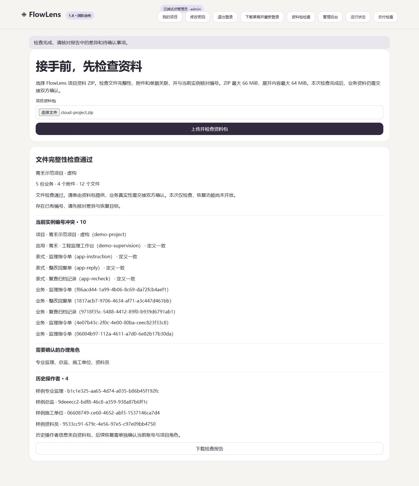

# FlowLens 1.8.0 · 接手前的资料检查

2026-11-04

收到一份项目资料，先确认文件齐不齐，再看看与当前系统有什么冲突。管理员现在可以上传 FlowLens 项目 ZIP，得到文件完整性、编号冲突、表式差异和历史操作者报告。

## 检查内容

- ZIP 目录与文件头、路径、重复文件、CRC、展开长度及文件总量。
- 清单覆盖范围、文件大小和 SHA256，以及附件与业务记录的对应关系。
- 项目内单据关联、表式结构和历史操作者格式。
- 当前实例已有编号、应用及表式定义是否一致、需要确认的办理角色。

报告可以下载，重新选择文件时旧结果会清除。检查页使用文字展示结果。资料包中的 HTML 保留在包内交接。

## 使用边界

仅管理员可以上传检查。ZIP 最大 66 MiB，展开内容最大 64 MiB，最多 10000 个文件。支持 FlowLens 资料格式的存储或 Deflate ZIP。分卷、加密、数据描述符、不符合路径约定的条目会被拒绝。解压同时限制实际输出大小。

本版完成检查与恢复预检，资料包恢复仍在后续实施计划中。当前实例的业务资料保持原样。历史操作者来自资料包，当前账号与办理权限需要另行确认。文件哈希与包内清单核对，业务真实性由交接双方确认。

## 已有验收

Windows、Ubuntu 各通过 87 项回归，Linux 容器和 Compose 验收通过。异常样例覆盖缺文件、额外文件、重复条目、路径穿越、伪造展开长度、截断、加密、符号链接及损坏 CRC。HTTP 检查覆盖普通成员拒绝、管理员有效包检查、失败后重试，以及原业务保持一致。

浏览器完成真实导出包上传、25.3 MB 样例包检查、报告下载核对、切换文件清除旧报告及损坏包拒绝。本机 Windows / Node.js 24.17.0 检查包含 5 份业务、4 个附件的样例耗时约 36 ms，进程峰值约 82 MiB。此结果用于记录单次测量，实际负载继续按试点验证。

云端已完成备份升级，公开 HTTPS 接口及浏览器上传检查通过。25,291,899 字节的样例包在接口测量中上传并检查约 4.1 秒，识别 5 份业务、4 个附件和 10 个已有编号。无效 ZIP 与普通成员请求被拒绝，检查前后业务工作区一致。

数据库结构继续使用版本 2。升级前备份并保留上一版程序，替换运行包后重启。真实业务确认、长期备份安排与运行观察继续保留在交付清单中。离线索引视觉验收 Q01 仍待用户确认。

[部署与使用](team-deployment.md) · [资料检查与恢复计划](project-import-plan.md) · [持续交付计划](delivery-plan.md)

[跨平台与容器验收](https://github.com/hanxiaochi/FlowLens/actions/runs/41682434993)
