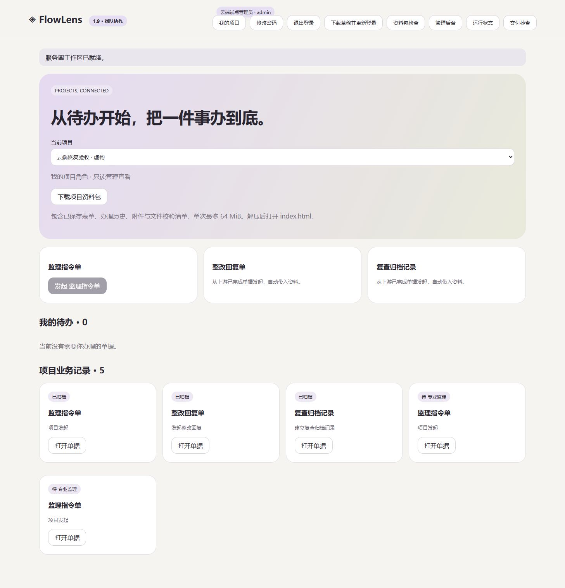

# FlowLens 1.9.0 · 把项目资料接回来

2026-11-04

资料包检查通过后，可以继续恢复到一个新项目。先填写项目名称、安排成员角色，再核对新增内容并确认。恢复完成后，接手的人能从原来的办理阶段继续做。

## 恢复过程

- 预览新增应用、表式、业务数量、附件用量和未分配角色。
- 创建独立的内部编号，重建单据关联及字段来源，提供原编号映射报告。
- 保留已填写内容、业务编号文本、历史表式版本和办理状态。
- 外部历史操作者明确标记，本次恢复操作者由目标实例记录。
- 提交前重验资料包、实例修订和成员状态，附件、业务、成员安排、审计与回执同事务写入。

## 断线后继续

确认请求发送前，浏览器保存本次恢复参数及编号映射。收到结果后清除待重试状态。连接中断时可以刷新页面，从顶部“继续待确认恢复”重选同一份 ZIP，再次提交原请求。服务器会返回已完成结果，或重新核验后执行。

清理站点存储会移除本机重试信息。遇到结果不确定的情况，先核对项目列表，避免误发新的恢复请求。ZIP 原文件需要自行保管。

## 验收

Windows、Ubuntu 各通过 91 项回归，Linux 容器与 Compose 验收通过。测试覆盖关联恢复、当前成员继续办理、历史角色兼容、资料或实例变化、目标成员停用、明确确认、重复请求、尾部写入失败回滚及备份恢复后的附件和操作回执。

浏览器以虚构包恢复出 5 份业务，随后用受控代理丢弃一次成功响应。刷新并重试后，数据库中只有一份对应项目及业务，未重复创建。恢复报告、外部历史标记及附件哈希均已核对。

云端已备份升级并保留一个“云端恢复验收 · 虚构”项目，包含 5 份业务。原项目保持一致，四个附件逐个下载核对哈希通过。错误角色修改被拒绝，目标专业监理账号继续保存成功。一次 25.3 MB 资料包的恢复请求约 5.1 秒，此测量对应当前虚构样例。

恢复后的云端数据另做了一次备份还原演练。新副本中两个项目、十份业务、成员和回执保持一致，四份独立附件校验通过，旧会话清空。实际服务继续使用原数据库。

## 使用范围

当前恢复到独立的新项目。已有项目合并需要独立的差异选择与确认规则，继续按实施计划推进。新上传附件沿用既有上限，历史资料按原格式保留并在恢复前检查工作区容量。

ZIP 最大 66 MiB，展开内容最大 64 MiB，最多 10000 个文件。单次最多安排 100 个账号，每个账号最多 30 个角色，编码后的恢复参数最大 64 KiB。数据库结构继续使用版本 2，升级前备份并保留上一版程序。

真实表式、业务负责人、维护安排、持续运行观察及离线索引视觉验收 Q01 仍在待确认清单中。

[部署与恢复](team-deployment.md) · [实施记录](project-import-plan.md) · [持续交付计划](delivery-plan.md)

[跨平台与容器验收](https://github.com/hanxiaochi/FlowLens/actions/runs/41690039458)
