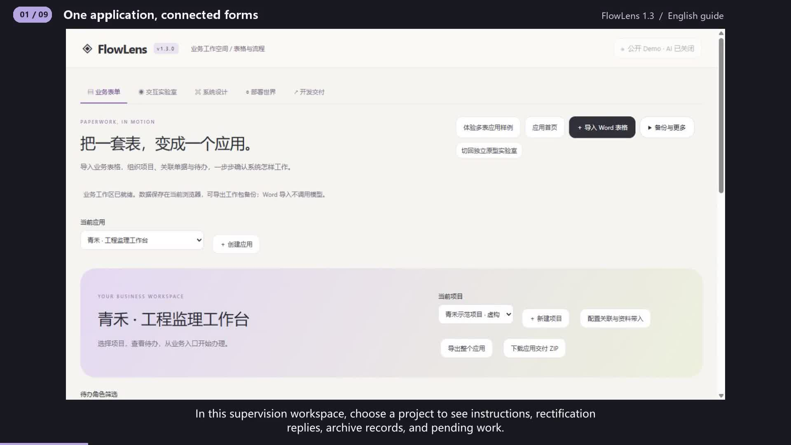

# FlowLens 1.3 walkthrough

Step-by-step captures of the actual UI, with synthesized narration and subtitles. Fictional supervision data. Public AI generation is disabled.

## 00:00 One application, connected forms

FlowLens 1.3 organizes related business forms into an application. In this supervision workspace, choose a project to see instructions, rectification replies, archive records, and pending work. Project details can be reused across forms.

## 00:17 Fill an instruction and its detail rows

Open the instruction and enter its number, requirements, and deadline. Add detail rows for each inspection location. Each row has an issue and a quantity. Two plus three gives a total of five. Drafts may be incomplete. Submission checks the required cells in every row.

## 00:38 Create a linked rectification reply

After the director signs off, return to the workspace and create the linked reply. The new record carries over the project, contractor, instruction number, and requirements. It also records the source revision. Repeating this action opens the existing reply.

## 00:57 Return a failed review for correction

The contractor describes the correction and submits it. Switch to the supervisor, choose the failed review result, and enter a reason. Continue applies the configured condition and returns the reply to the contractor. The record keeps its identity and full history.

## 01:15 Restore the application and continue

Export the application to keep its templates, projects, relationships, and records together. Restore the package through the backup menu. The current workspace is backed up first. The returned reply can then be corrected, resubmitted, and approved using the same record.

## 01:34 Follow the chain across three records

Once the reply is approved, create its archive record. The correction summary and review result are carried over. The records officer completes the archive number. The interaction view shows the upstream document, its revision, and the changes saved in this operation.

## 01:53 Preview rule changes in plain language

In template settings, describe a rule and inspect the proposed change. For example, a failed review can return to the contractor. Confirm the proposal to save it. The local assistant supports required fields, stage roles, and conditional returns. Updated templates apply to newly created records.

## 02:15 Understand devices, networks, and deployment

Deployment World explains how this business could run across devices, networks, servers, and a database. Explore mobile access and failure scenarios. Current business operations are stored in the browser. Multiuser deployment still requires server authentication, project permissions, transactions, and recovery.

## 02:37 Hand the application to an implementer

Download the application handoff ZIP. It includes the restorable application, API and database drafts, and a local rule verifier. With Node.js installed, run the included verify-app script to check the application structure and template rules. Use this working business example to plan the next implementation step.
