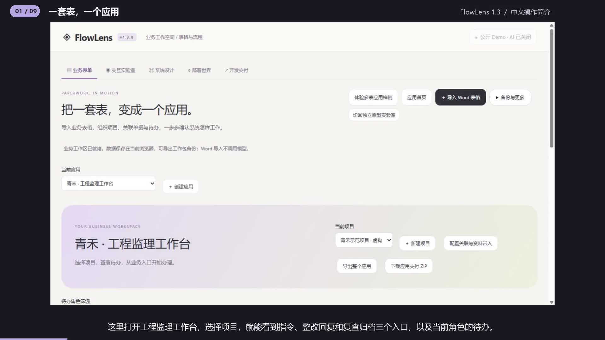

# FlowLens 1.3 操作简介

实际页面分步画面、合成旁白和字幕。使用虚构监理项目，公开版 AI 关闭。

## 00:00 一套表，一个应用

FlowLens 一点三把一套业务表组织成一个应用。这里打开工程监理工作台，选择项目，就能看到指令、整改回复和复查归档三个入口，以及当前角色的待办。项目名称和施工单位只需配置一次。

## 00:18 填写指令与检查明细

打开监理指令，填写编号、整改要求和期限。在检查明细中添加多个部位，每一行都有自己的问题说明和数量。这里两行数量分别是二和三，合计五。草稿可以暂时没填完，提交时会检查每行必填项。

## 00:38 从指令发起整改回复

总监填写意见并签发后，回到应用首页，点击发起整改回复。新单据自动带入项目、施工单位、指令编号和原指令要求，同时记下来源修订。再次点击同一个发起按钮，会打开已经建立的回复单。

## 00:58 条件不通过，退回修改

施工单位填写整改说明并提交。切换到专业监理，选择不通过，填写复查意见和退回原因，再点击继续。确认过的条件规则会把这份回复退回施工单位。原编号和每次办理的历史都保留下来。

## 01:17 带着整个应用继续办理

导出整个应用，可以带走模板、项目、关联关系和业务记录。通过恢复工作包选择文件，先备份当前工作区，再恢复。刚才被退回的回复单仍然可以补充内容、重新提交，并由监理复查通过。

## 01:36 追溯三张单据的业务链

回复通过后，建立复查归档记录，自动带入整改摘要和复查结论。资料员填写归档编号，完成签收。交互实验室会说明这份记录来自哪一张单据、读取的是哪次修订，以及本次保存改变了什么。

## 01:55 用自然语言预览规则修改

模板配置里可以用一句话调整规则。例如，复查不通过就退回施工单位。助手先展示将修改的字段、阶段和目标，点击确认后才保存。当前版本支持常用的必填、办理角色和条件退回句式，模板修改会用于后续新建的单据。

## 02:17 理解设备、网络与部署

部署世界展示当前业务未来如何经过设备、网络、服务器和数据库。可以切换手机访问和故障条件，观察链路。现在的业务操作保存在浏览器中。正式多人上线还要实现账号、项目权限、服务器事务和备份恢复。

## 02:39 导出给下一位实施者

最后下载应用交付压缩包。其中包含可恢复的应用文件、各模板的接口与数据库草案，以及本地规则验证器。在安装了 Node 的电脑上，运行 verify app，就能检查应用结构和模板规则。带着这套可操作的业务，继续和实施工程师确认下一步。
